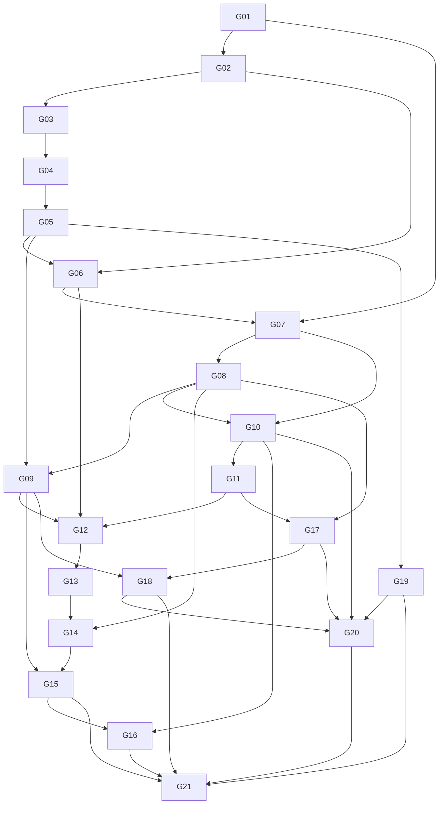
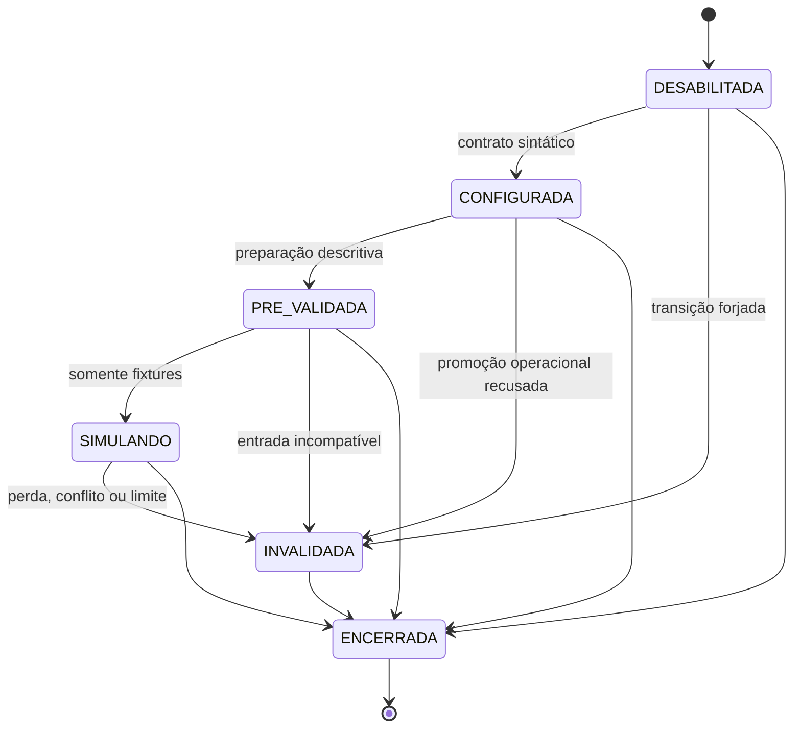

# V03-F1-P01 — Preparação do executor D/V sob cgroup

Base `375fef13b5442fa480a25760187c179927763d35`, `devs` inicialmente limpa e sincronizada. O usuário informou **9/9 controles sintéticos aprovados no hospedeiro**, política `continue` confirmada, `memory.max=50331648`, `memory.swap.max=0`, `oom_kill=1`, pressão −9, evidência completa e limpeza, duração 1,51 s. É relato do usuário preservado como tal; não foi repetido nem auditado independentemente aqui. [D04-E03](protocolos/V03-F1-P01_D04-E03_memoria_cgroup_APROVADA.md), [D04-E02](protocolos/V03-F1-P01_D04-E02_dados_vivos_APROVADA.md), [D01–D03](V03-F1-P01_decisoes_metodologicas_pre_finais_APROVADAS.md), [protocolo](protocolos/V03-F1-P01_confiabilidade_experimental_inicial_PROPOSTA.md) e [histórico](V03-F1-P01_instrumentos_controles_cgroup.md) permanecem inalterados.

## Arquitetura e contrato

`tests/support/v03_f1_p01/dv_cgroup_executor.py` prepara um supervisor externo e coordenador num scope systemd transitório próprio com `MemoryMax=268435456`. A interface pública exige a opção explícita `--execute-dv-with-explicit-authorization`; ela expressa a escolha operacional e **não é, por si, autorização humana**. Esta atividade não autoriza usá-la. Não há opção para F; as únicas seleções do binário são `--exact development` e `--exact validation`. O gerador existente continua rejeitando partições fora de D/V.

Antes de qualquer consulta, supervisor e coordenador verificam o `memory.max` efetivo; o supervisor confronta unidade ativa, caminho e PID no cgroup e somente então envia liberação. O coordenador confere liberação, PID e caminho; antes das partições revalida o teto e exige pelo menos 3 GiB disponíveis em `/home`. O supervisor verifica esse espaço antes de criar o scope e novamente antes da liberação. O relógio monotônico externo inicia antes do scope e impõe prazo inferior a 30 segundos para a execução e processos auxiliares; timeout tenta parar somente o scope próprio. Limpeza e consultas posteriores têm tempo separado registrado, sem alegar que ocorreram dentro dos 30 segundos.

O cgroup abrange coordenador, processo de teste, referência e comparações executadas no processo de teste, e os filhos lançados por ele para restaurar checkpoint. O supervisor e seus comandos `systemctl` ficam fora: sua função, PID, duração e exclusão de memória são registrados; não fazem inferência nem escolhem respostas. São capturados versão do executor por SHA-256, parâmetros do comando, hash e caminho do binário D/V, limites ancestrais legíveis, espaço, `memory.current`, `memory.peak` quando disponível, `memory.events`, PIDs observados, saídas e códigos. Não se trata bytes de checkpoint ou RSS como memória do cgroup; 256 KiB de dados vivos continuam restrição não verificada.

O processo de teste é verificado explicitamente no cgroup e a composição do grupo é amostrada a cada 2 ms, com erros e PIDs não verificáveis registrados. **Limitação impeditiva:** filhos de restauração podem existir menos que o intervalo e a amostragem não comprova todos os descendentes ou ausência de escape. A herança usual do cgroup não substitui evidência individual. Por isso, mesmo se D/V forem futuramente executados, esta versão marca `descendant_membership=NAO_VERIFICADO_INTEGRALMENTE` e retorna **INCONCLUSIVO**, sem homologar contenção nem resultados por esse motivo. Os relatórios completos e as contagens impressas pelo teste permanecem disponíveis para avaliação, sem convertê-las em aprovação automática. Se houver falha, teto divergente, timeout ou limpeza não comprovada, registrar inconclusão; a limpeza tenta parar somente o scope próprio, sem presumir sucesso.

## Segurança e verificação desta preparação

Não se executaram D/V, F, EC-10 R3, pressão real, scope, congelamento ou alterações globais; não houve alterações em `src/` ou nos critérios científicos. Testes seguros de `test_dv_cgroup_executor_safe.py` usam mocks e arquivos temporários para verificar aceitação exclusiva de D/V, recusa por limite ou identidade ausentes, bloqueio sem liberação e recusa de espaço insuficiente, sem criar processos experimentais. `--help` apenas apresenta a opção; seu uso não valida o executor.

Quatro testes seguros passaram. `cargo fmt --check`, `cargo check --offline --all-targets` e `git diff --check` passaram. Regressão `cargo test --offline -- --skip development --skip validation --skip frozen --skip final --skip panel --skip protocol`: **98 aprovados, zero falhos e 93 filtrados**; D/V, F e R3 não executados. Três avisos históricos de métodos não usados na EC-04 permanecem. A regressão não substitui testes sob cgroup.

## Pendências para autorização de D/V

Auditar o executor e sua confirmação com systemd real; definir e implementar, sob autorização apropriada, observabilidade comprovável para todos os filhos de restauração e sobreviventes, sem inferir completude da amostragem; validar que interrupção e limpeza do grupo são efetivas, inclusive falhas e limites ancestrais. Reavaliar a prontidão operacional, registrar versões e recursos e obter **autorização humana específica posterior para executar D/V**. Se não for possível cumprir a rastreabilidade de descendentes, preservar resultado inconclusivo. Congelamento prospectivo não está aprovado; F não está autorizado e nenhuma competência foi homologada.

**Estado: controles sintéticos aprovados no hospedeiro conforme relato; executor D/V em preparação com limitação aberta; D/V sob contenção não executados; contenção D04-E03 integral não homologada.**

## Instrumentação prospectiva dos descendentes

Base `2529e0035743d0292d0c2feb0d06e0f502dab5d1`. A inspeção de `tests/v03_f1_p01_instruments.rs` identificou **um ponto centralizado** de criação dos filhos de restauração: o `Command` do próprio binário para `child_process`, uma vez para cada um dos seis casos em três repetições. A criação do processo de teste é feita pelo coordenador Python; o scope é iniciado pelo supervisor externo, que também usa `systemctl` para controle e limpeza. Esses processos externos são supervisão, não restauração ou inferência. Não foram identificados outros pontos explícitos de criação de processos experimentais nesse harness; isso não prova ausência em bibliotecas externas ou outros executores.

Quando habilitada pelo executor, a nova instrumentação é **opt-in**: o processo de teste comunica PID, PID do criador, ticks de início e cgroup e aguarda liberação do coordenador antes de qualquer consulta D/V. O coordenador confere `/proc` enquanto o processo está vivo. Cada filho de restauração envia identidade e aguarda o pai ler seu PID real, pai, ticks e cgroup, compará-los com a execução e com o grupo esperado e só então liberar a restauração. Se identidade, cgroup ou comunicação forem ausentes, divergentes ou incompletos, a sequência falha; um guard tenta matar e recolher o filho em falha normal ou unwind. Para cada filho concluído, o pai emite registro com run ID, partição/repetição/caso, papel, PID, criador, ticks, cgroup, tempos de criação/entrada/término, duração monotônica e código ou sinal. O coordenador exige 18 registros únicos por partição, com identidades, tempos, saída e cgroup coerentes, antes de prosseguir; registros ausentes, duplicados ou divergentes são rejeitados. Os registros são encaminhados ao supervisor externo no relatório; amostragem continua apenas complementar.

O handshake mantém o processo vivo durante a comparação e o par PID/ticks mitiga reutilização de PID; `ppid` e cgroup são verificados no momento da liberação. Filho curto sem handshake não consegue executar a restauração na modalidade rastreada. Uma falha de pipe, inicialização, timeout, OOM, morte abrupta do pai, filho órfão, escape posterior de cgroup ou remoção da unidade exige interrupção, limpeza e classificação inconclusiva; guard em unwind não garante limpeza após SIGKILL. O relógio de parede para instantes pode sofrer ajuste; duração monotônica é registrada separadamente e tempos incoerentes são rejeitados. O supervisor só recebe o relatório de uma partição após seu término, não uma prova em tempo real independente de todos os processos. Não há autenticação criptográfica de mensagens nem prova de que terceiros ou bibliotecas não criem processos não instrumentados. Não se declara cobertura integral fora dos caminhos identificados.

Sete testes Python seguros passaram para identidade de teste, registros completos, ausentes, duplicados, divergentes e liberação ausente; um teste Rust puro foi executado com filtro exato para validar falhas de comunicação, sem iniciar D/V. `cargo fmt --check`, `cargo check --offline --all-targets` e `git diff --check` passaram. Regressão `cargo test --offline -- --skip development --skip validation --skip frozen --skip final --skip panel --skip protocol`: **99 aprovados, zero falhos e 93 filtrados**; D/V, F e R3 não executados. O harness alterado preserva os caminhos históricos quando a variável de rastreio não está definida. Nenhuma execução real do handshake foi feita nesta etapa.

O executor continua deliberadamente a retornar **INCONCLUSIVO** após coletar os registros: falta validar o handshake, a integridade completa das saídas, descendentes e limpeza no hospedeiro real sob contenção; dependem de autorização humana posterior para D/V. A observabilidade preparada não homologa D04-E03, não aprova congelamento e não autoriza F.

## Validação sintética segura do handshake e limpeza

Base `03747ce5e81307391650e85ab8db94a711d58343`. A auditoria confirmou um ponto `Command` para restauração, dentro de seis casos e três repetições: **18 oportunidades de registro por partição** no caminho inspecionado. O teste sintético não executa esses casos nem carrega checkpoints. O comparador de registros exige exatamente esse conjunto, IDs e pares PID/ticks únicos, criador, cgroup, tempos e saída válidos; isso não demonstra caminhos não inspecionados.

Foram executados processos auxiliares reais de curta duração no cgroup já existente da sessão, sem scope novo ou pressão: handshake válido com leitura real de `/proc`, confirmação de PID, geração, pai, cgroup, identidade e liberação antes do trabalho; saída normal; e carga de 128 KiB em `stderr`. Foram exercitados ausência ou divergência de identidade, término prematuro, marcador duplicado, canal de entrada fechado, liberação inválida e timeout. Os filhos diretos desses testes foram aguardados e sua ausência em `/proc` verificada. Um teste Python criou pai e descendente sintéticos, detectou o descendente ativo, encerrou-o por meio do pai e confirmou que foi recolhido. Os testes de registros ausentes/duplicados e cgroup divergente são também exercitados por dados simulados, não por D/V.

A auditoria identificou bloqueio potencial ao esperar `stdout` enquanto `stderr` enchia e ausência de prazo local na espera do filho. O caminho rastreado agora drena ambos em paralelo, limita dados retidos e aplica prazo local de três segundos; falhas normais e unwind acionam guarda que tenta matar e recolher o filho direto. O executor rejeita lista final com processo além do coordenador. O primeiro teste sintético falhou porque o simulador usou `sys.stdin.close()` sem fechar o descritor efetivo; após correção para `os.close(0)`, repetição passou. O resultado anterior não foi apresentado como sucesso.

Limites: a leitura de identidade do processo de teste pelo coordenador Python ainda pode bloquear em `readline` ou por `stderr` antes da liberação; o supervisor externo dispõe do prazo global e tenta parar o scope, mas isso não foi validado sob systemd nesta atividade. Leituras muito grandes sem quebra de linha, falha de comunicação do supervisor, cgroup inacessível, OOM, SIGKILL do pai e netos que escapem da contenção não foram comprovados em ambiente real. A guarda local não garante recolher descendentes órfãos após morte abrupta. O teste de descendente ativo verifica o caso sintético controlado, não todos os caminhos de falha. PID/ticks e cgroup observados são verificações locais, não autenticação externa. O executor continua **INCONCLUSIVO**.

Verificações finais: dois testes Rust de processos sintéticos passaram (`trace::tests::safe_`, execução serial, cinco testes do binário filtrados); oito testes Python seguros passaram. `cargo fmt --check`, `cargo check --offline --all-targets` e `git diff --check` passaram. Regressão `cargo test --offline -- --skip development --skip validation --skip frozen --skip final --skip panel --skip protocol`: **102 aprovados, zero falhos e 93 filtrados**; D/V, F e R3 não executados. Os controles sintéticos cgroup seguem aprovados no hospedeiro apenas conforme relato anterior; não foram repetidos aqui. Falta validar handshake e limpeza no hospedeiro sob cgroup apropriado com autorização específica, depois avaliar D/V; nenhum congelamento ou F autorizado.

## Supervisão externa e limpeza prospectiva

Base `e55209f77a5cba0fcbbe8502b8e408c99ee0083f`. A auditoria encontrou `readline()` sem prazo na espera de `V03TEST_READY` e possível bloqueio de `stderr` antes da liberação. O coordenador agora usa leitura por descritor com deadline monotônico e teto de 64 KiB para a identidade; `stderr` vai para arquivo temporário próprio, evitando encher um pipe. Timeout, EOF ou excesso impedem liberação. O supervisor externo mantém prazo global e aciona somente `systemctl --user stop` para nome próprio validado; reconsulta estado e registra falha de comando, unidade `failed` ou limpeza não comprovada como **INCONCLUSIVO**. Não envia sinais a grupos arbitrários. Se stop falhar, a ausência de sobreviventes não é presumida. Os arquivos temporários de `stderr` são anônimos e encerrados pelo processo.

Foi preparado `tests/support/v03_f1_p01/synthetic_scope_cleanup.py`: um supervisor externo cria um scope sintético próprio de 64 MiB, com coordenador, filho e neto sem checkpoints; registra identidades e cgroup, provoca saída abrupta do coordenador e solicita stop apenas do scope gerado. Registra estado e PIDs ainda presentes; resultado permanece **INCONCLUSIVO** para inspeção. É um ensaio prospectivo, não valida limpeza automaticamente. Não executado aqui porque `systemctl --user show` retornou `Operação não permitida` nesta sessão. Não se criou scope, não se alterou configuração global e não houve pressão/OOM ou D/V.

Para futura execução **com autorização humana específica**, no terminal do hospedeiro:

```sh
python3 -B tests/support/v03_f1_p01/synthetic_scope_cleanup.py --run-host-synthetic
```

O teste provoca falha intencional do coordenador sintético; registrar integralmente nome único do scope, saídas, retorno, PIDs e evidências. Se stop falhar ou houver sobreviventes, interromper e investigar; no hospedeiro, o operador pode parar somente a unidade própria impressa com `systemctl --user stop NOME.scope` após conferir sua identidade, sem agir sobre grupos compartilhados. Não executar no sandbox para contorná-lo. A evidência de processos após término é limitada por acesso a `/proc`, reutilização de PID e estados zumbis; falha de leitura ou identidade mantém inconclusão. O mecanismo de stop não depende da cooperação do coordenador, mas sua eficácia real sob systemd ainda não foi demonstrada aqui.

O stop automático exige tanto o padrão de nome próprio quanto confirmação prévia da identidade e do pertencimento do scope; nome aleatório isolado não autoriza interromper uma unidade. Se a confirmação não ocorrer, o instrumento não emite stop e registra inconclusão, podendo exigir inspeção manual da unidade impressa. Nenhum sinal global é enviado.

Verificações: 11 testes Python seguros passaram, incluindo pipes reais com deadline, EOF e marcador válido, falha simulada de stop, estado `failed` e recusa de unidade externa; dois testes Rust sintéticos de handshake passaram. `cargo fmt --check`, `cargo check --offline --all-targets` e `git diff --check` passaram. Regressão filtrada `cargo test --offline -- --skip development --skip validation --skip frozen --skip final --skip panel --skip protocol`: **102 aprovados, zero falhos e 93 filtrados**; D/V, F e R3 não executados. A limpeza após falha abrupta sob scope real permanece pendente de execução autorizada; executor D/V permanece inconclusivo, sem congelamento ou F.

## Recuperação após confirmação parcial

Base `ee45ec24088c378248e9d349f46222211e1986c0`. A versão anterior somente autorizava a limpeza depois de confirmar todos os descendentes a partir do marcador deles. Uma falha antes desse marcador podia deixar um scope próprio ativo sem tentativa de stop, mesmo que fosse possível identificá-lo por evidências independentes.

A versão preparada separa três condições: **propriedade da unidade**, **liberação do trabalho** e **limpeza**. Antes de liberar o coordenador sintético, o supervisor confronta o PID do processo que ele próprio lançou, seu criador e ticks de início lidos duas vezes em `/proc`, cgroup, estado ativo, caminho e `InvocationID` não vazio da unidade consultada ao systemd. Essa prova não depende do marcador dos descendentes. Só então envia uma liberação ligada a PID, ticks, unidade e cgroup; o coordenador valida esses campos antes de criar trabalho sintético. Marcador posterior ausente, parcial ou divergente não autoriza trabalho adicional, mas não descarta a prova independente já obtida para limpeza.

Antes de `systemctl stop`, o instrumento exige prova tipada pertencente ao supervisor, nome próprio válido e nova consulta com **mesmo `InvocationID` e cgroup**; falha de consulta, mudança de unidade ou prova ausente impedem stop e produzem diagnóstico inconclusivo. A consulta e o stop são operações distintas: há uma janela residual de corrida, portanto não se alega ligação atômica ao `InvocationID` nem proteção contra substituição adversarial entre as chamadas. Se esse risco não for aceitável para uma execução, o stop automático não deve ser usado até haver mecanismo apropriado. Falha de stop, unidade `failed`, grupo desconhecido e limpeza não comprovada permanecem inconclusivos. A verificação posterior distingue sobrevivente com mesmos PID/ticks de PID reutilizado e registra identidades desconhecidas; marcador ausente não é interpretado como lista vazia comprovada. O executor D/V usa a mesma prova independente para suas tentativas de limpeza, sem autorizar D/V nesta atividade.

O teste real de scope no hospedeiro **não foi executado**. Passaram 16 testes Python seguros com mocks e processos locais, incluindo falha antes da confirmação dos três processos, marcador ausente ou divergente, coordenador encerrado, PID reutilizado, barramento/stop indisponíveis e recusa de unidade externa; dois testes Rust sintéticos passaram. `cargo fmt --check`, `cargo check --offline --all-targets` e `git diff --check` passaram. Regressão filtrada `cargo test --offline -- --skip development --skip validation --skip frozen --skip final --skip panel --skip protocol`: **102 aprovados, zero falhos e 93 filtrados**; D/V, F e R3 não executados. A comprovação do comportamento real de `InvocationID`, timeout, descendentes e limpeza no hospedeiro continua pendente de autorização específica; não há homologação da contenção.

## Identidade do lançador e do coordenador

Base `2e471c79aafd3ece5d9b3b7552f13390ab67ed5d`. A auditoria do [código upstream systemd v252](https://github.com/systemd/systemd/blob/v252/src/run/run.c), família do Debian 12, identificou que `transient_scope_set_properties()` registra `getpid_cached()` em `PIDs` e `start_transient_scope()` termina com `execvpe()`. Nesse caminho local `--user --scope`, o lançador é substituído pelo comando, preservando PID e ticks; não há necessariamente dois processos simultâneos. A hipótese de que a igualdade sempre falharia não se confirma nesse código. Não se executou systemd-run nem scope real para confirmar o comportamento do pacote instalado.

A prova agora distingue supervisor, lançador e coordenador explicitamente. O lançador vem de `Popen`; seu parentesco com o supervisor, geração e cgroup são lidos antes/depois. O coordenador é descoberto por `cgroup.procs` do caminho consultado no systemd, sem PID fornecido por marcador: exige candidato único vivo com argumentos exatos do Python/script/modo esperado, parentesco e PID/ticks/cgroup estáveis, com nova leitura antes de concluir a prova. Aceita o mesmo PID após exec ou filho direto do lançador com PID distinto; nesse segundo caso não exige que o lançador pertença ao scope. Outros arranjos de parentesco, processos inacessíveis, ausência, ambiguidade ou saída durante atestação não produzem prova. Argumentos e parentesco são evidência local combinada, não autenticação contra processos adversariais com privilégios equivalentes.

`ScopeOwnership` registra separadamente PID/ticks do lançador e PID/ticks/pai do coordenador, supervisor, unidade, cgroup e `InvocationID`. Liberação e marcador são confrontados com a identidade do coordenador. A prova completa é registrada antes da liberação sintética e pelo supervisor D/V prospectivo. Identificação incompleta impede liberação e stop automático; uma prova já concluída permanece utilizável após falhas posteriores de comunicação ou saída do coordenador, sujeita à reconsulta da mesma unidade antes do stop. Logs de liberação, propriedade e resultado de limpeza permanecem distintos. Não se presume ausência de descendentes quando falta marcador.

Passaram **19 testes Python seguros**, incluindo descoberta por evidência do kernel simulada, lançador fora do cgroup com coordenador distinto, argumentos/parentesco/cgroup divergentes, múltiplos candidatos, coordenador encerrado durante atestação e os caminhos anteriores de falha antes/depois da prova, marcador ausente e substituição de unidade. Passaram dois testes Rust sintéticos, `cargo fmt --check`, `cargo check --offline --all-targets` e `git diff --check`. Regressão filtrada: **102 aprovados, zero falhos e 93 filtrados**. Permanecem três avisos históricos de métodos não usados na EC-04.

Limitações: não há prova antes de identificar um coordenador vivo; se ele morrer antes dessa etapa, a limpeza automática é recusada e requer inspeção humana. A janela entre consulta de `InvocationID` e stop continua não atômica. Não há suporte presumido a coordenadores reparentados ou wrappers arbitrários. Validação real de lançamento, prazos e limpeza sob systemd permanece pendente. Não se executaram scope real, D/V, F, EC-10 R3 ou pressão/OOM; `src/` e critérios científicos não foram modificados.

**Estado: controles sintéticos aprovados no hospedeiro conforme relato anterior; limpeza após falha abrupta com validação real pendente; D/V não executado; D04-E03 não homologada; congelamento não aprovado; painel F não autorizado.**

## Correção consolidada F1, F2 e F3

Base `5eabe7342e9d6f594393c987c2f9aaad15130e6e`. Nenhum ensaio no hospedeiro ou scope real foi executado nesta atividade.

**F1 — finalização independente.** `close_channel()` converte BrokenPipeError/OSError e canal inválido em diagnóstico; canal já fechado é aceito. `finish_owned_scope()` preserva a prova recebida e tenta `stop_owned_scope()` independentemente desses erros, registrando separadamente `channel_close` e `cleanup`, inclusive se ambas falharem. O sintético usa essa finalização no finally. A auditoria confirmou o mesmo problema no supervisor D/V: o fechamento do preflight também passa a ser diagnosticado, e a finalização com tentativa de limpeza ocorre no finally tanto no timeout quanto na saída normal ou erro. Essa tentativa permanece sujeita à prova de propriedade e reconsulta; não envia sinais nem autoriza parada de unidade externa. Garantia restrita às falhas de canal tratadas, não à eficácia do stop ou à morte do próprio supervisor.

**F2 — leitura limitada.** As duas sequências select/readline do coordenador sintético foram substituídas por `read_limited_line()`: descritor temporariamente não bloqueante, selector, deadline monotônico absoluto, teto de 65.536 bytes incluindo newline, EOF vazio/parcial explícito e UTF-8 estrito. Linha parcial com escritor aberto expira; EOF antes do newline é falha. O modo original do descritor é restaurado. A liberação do worker D/V também usa esse leitor, dentro do prazo já existente de 30 segundos. JSON inválido ou liberação que não seja objeto não libera trabalho. Nenhuma thread ou processo de leitura foi introduzido. Os auxiliares reais dos testes seguros são encerrados e recolhidos em finally.

**F3 — representação canônica.** `live_process()` continua devolvendo caminho completo do filesystem. A comparação agora usa `cgroup_relative()`, cujo resultado é o caminho absoluto na hierarquia do controlador, como `/user.slice/.../nome.scope`, equivalente ao campo `0::` do kernel. Caminho completo `/sys/fs/cgroup/...` é convertido para esse formato; caminho da hierarquia já nesse formato é aceito; componentes ponto/ponto-ponto e caminhos sem barra inicial são recusados. `verify_live_test_ready()` confronta o processo vivo, PPID, ticks, pertencimento esperado e identidade do marcador. Somente o campo cgroup é normalizado: run ID, PID, PPID e ticks continuam exigindo igualdade. A verificação prévia de inclusão no scope e o teto de memória permanecem.

Verificações: **27 testes Python seguros do executor e 10 dos controles**, dois testes Rust sintéticos, `cargo fmt --check`, `cargo check --offline --all-targets` e `git diff --check` passaram. Regressão `cargo test --offline -- --skip development --skip validation --skip frozen --skip final --skip panel --skip protocol`: **102 aprovados, zero falhos e 93 filtrados**. Os comandos Rust removeram do próprio ambiente as variáveis opcionais de caso/checkpoint D/V e trace para impedir ativação incidental. Permanecem três avisos históricos EC-04. Os dois testes Rust específicos também integram a regressão, não são cobertura independente somável.

Cenários novos: BrokenPipeError/OSError no fechamento com prova preservada, falha simultânea de fechamento e stop, canal já fechado, falha de stop/barramento, finalização do supervisor D/V com mocks, pipe real com linha parcial e escritor aberto, EOF vazio/parcial, excesso de bytes, UTF-8 inválido, duas linhas sem perda, auxiliares curtos recolhidos após sucesso/EOF/timeout, JSON/liberação inválidos sem spawn, cgroups completo/hierárquico válidos e divergências de pertencimento, PID, PPID, ticks e marcador. Testes de recusa de unidade externa e de substituição de InvocationID continuam aprovados.

### Auditoria complementar e pendências preservadas

Não se demonstrou ausência integral de descendentes. O relatório sintético continua INCONCLUSIVO; sem marcador, a lista de descendentes continua desconhecida. Uma futura prova exige identidade da unidade preservada, estado systemd coerente, verificação de população de todo o cgroup/subgrupos (`cgroup.events`/`populated` e enumeração pertinente), confronto dos processos conhecidos por PID/ticks, tratamento de zumbis e evidência independente contra escape. Grupo vazio isolado não demonstra que um descendente não escapou; unidade desaparecida ou PID ausente isoladamente tampouco basta. Essa instrumentação adicional não foi implementada nem validada aqui.

A corrida entre reconsulta de InvocationID/cgroup e stop por nome permanece não atômica. Sem prova antes da morte do coordenador, o stop automático permanece recusado. No supervisor D/V, o acionamento da atestação ainda depende de DV_READY; prova já obtida não é apagada por falha posterior de canal. A morte do supervisor externo não tem recuperação integral demonstrada.

Outros caminhos examinados: `read_test_ready()` tem deadline e teto de saída, `communicate()` e waits Python pertinentes possuem timeout; entretanto escritas/flush/close de pipes continuam síncronos e não têm deadline próprio. A separação de exceções F1 não prova interrupção de uma operação de close que fique bloqueada. `trace.rs` mantém gates com read_line, espera do ChildGuard sem timeout próprio e leitores auxiliares; há fiscalização externa em outros caminhos, mas não se declara prazo universal nem ausência de bloqueios em todos os cenários. O instrumento histórico cgroup_controls mantém caminhos antigos de comunicação e stop por nome e não foi promovido à mesma garantia de propriedade desta finalização. Nenhuma dessas limitações foi declarada resolvida por F1–F3.

Antes de autorizar scope real: auditoria independente do commit, decisão sobre suficiência da prova de limpeza e risco de corrida, revisão dos prazos restantes, confirmação no terminal Debian 12 de versões, barramento, delegação, limites efetivos, política de interrupção, observabilidade e recuperação manual de unidade própria. O comando sintético histórico é apenas referência; esta correção não autoriza sua execução. Controles de memória aprovados anteriormente não substituem a validação real de limpeza.

**Estado: controles sintéticos aprovados no hospedeiro conforme evidência anterior; limpeza após falha abrupta com validação real pendente; D/V não executado; D04-E03 integral não homologada; congelamento não aprovado; painel F não autorizado.**

## Política de parada, prazos e população independente

Base `1483a166cef63ade4f42e5f7602ca093aaa36941`. **IMPLEMENTADO e VALIDADO POR TESTES SEGUROS; PENDENTE DE VALIDAÇÃO REAL.** Nenhum scope, ensaio no hospedeiro, D/V, F, EC-10 R3, checkpoint D/V ou pressão/OOM foi executado nesta atividade. A falha abrupta permanece exclusivamente a saída 77 do coordenador; morte do supervisor externo não faz parte do ensaio.

### Auditoria systemd v252 e política própria

Fontes upstream: [cliente de propriedades](https://github.com/systemd/systemd/blob/v252/src/shared/bus-unit-util.c), [D-Bus de scope](https://github.com/systemd/systemd/blob/v252/src/core/dbus-scope.c), [contexto de sinais](https://github.com/systemd/systemd/blob/v252/src/core/dbus-kill.c) e [propriedades cgroup](https://github.com/systemd/systemd/blob/v252/src/core/dbus-cgroup.c). O cliente UNIT_SCOPE aceita propriedades de cgroup, kill e scope; `TimeoutStopSec` é convertido para `TimeoutStopUSec`. O gerenciador admite essas propriedades no estado de criação da unidade transitória. Não se deduziu a política a partir de um scope alheio nem se alterou unidade histórica.

| Propriedade | Configuração proposta no lançamento | Verificação da própria unidade |
|---|---|---|
| MemoryMax | 67108864 | MemoryMax e leitura independente de memory.max |
| KillMode | control-group | Igualdade exata; process/mixed/none recusados |
| KillSignal | SIGTERM | KillSignal=15 |
| FinalKillSignal | SIGKILL | FinalKillSignal=9 |
| SendSIGKILL | yes | Igualdade exata |
| TimeoutStopSec | 2s | TimeoutStopUSec=2s na saída systemctl show |
| OOMPolicy | Não configurada | Não aparece no caminho de propriedades de scope upstream v252; ausência registrada como INDISPONIVEL_NAO_REQUERIDA neste ensaio sem pressão |
| Id, InvocationID, ControlGroup, estados e Result | Somente observação; não são prova por nome isolado | Confrontados com a prova independente |

Os defaults do gerenciador seriam usados para valores omitidos; a política de parada acima é explicitamente solicitada, não herdada de outra unidade. Não se alega que um barramento ou pacote específico aceitará a solicitação: recusa ou propriedade ausente/divergente impede liberação e registra inconclusão. A prova PID/PPID/ticks/cgroup/InvocationID foi preservada. Antes da liberação, a consulta da unidade, memory.max e identidade/cgroup do supervisor externo são conferidos. A coleta inicial deve ser completa e conter PID/ticks do coordenador. O supervisor deve estar fora do scope e de seus subgrupos.

### Orçamento temporal do ensaio sintético

| Fase | Orçamento configurado |
|---|---|
| Descoberta/atestação | Até 4 s desde início; cada consulta limitada ao restante ou 1 s |
| Política e liberação | Consulta 1 s, coleta inicial 0,25 s e escrita não bloqueante 0,25 s; coordenador espera liberação por até 7 s desde sua entrada |
| Marcador de trabalho | Até 9 s desde início; leitura local do marcador do filho tem 3 s |
| Confirmação da falha abrupta | wait de até 2 s, exigindo saída 77 |
| Coleta anterior ao stop | Até 2 s |
| Reconsulta da unidade | Até 1 s |
| Solicitação de stop | systemctl --user --no-block stop; cliente limitado a 1 s |
| Conclusão | Até 5 s após a solicitação; consultas de até 1 s ou restante e amostras de até 0,25 s |
| Verificação final | Até 2 s compartilhados entre coleta e identidades conhecidas |

O caminho nominal de supervisão tem orçamento aproximado de 22 s, com margem operacional proposta de 24 s para revisão humana; essa margem não é um watchdog externo implementado nem garantia de tempo real. Os 5 s de conclusão excedem o TimeoutStopSec solicitado de 2 s, deixando margem para a escalada e comunicação; o comportamento real ainda deve ser confirmado. Timeout do cliente não significa conclusão nem cancelamento do job: o gerenciador pode continuar a parada. Falha de solicitação, consulta, estado failed ou prazo sem conclusão comprovada permanece INCONCLUSIVO, mesmo que uma consulta posterior mostre inatividade.

A escrita da liberação sintética usa descritor não bloqueante, mensagem de até 4096 bytes, deadline e pipe sem buffering; não há threads auxiliares novas. Leituras de população são limitadas a 16 KiB por arquivo, 64 grupos e 512 IDs por amostra, e 4096 identidades acumuladas na verificação final; excesso é evidência incompleta. Chamadas de filesystem/proc, criação de processos, escrita dos relatórios e escalonamento do kernel não têm garantia de latência absoluta. Prazos de espaço de usuário não resolvem processo em estado ininterruptível nem morte do supervisor. Não se declara deadline universal do sistema.

### Coleta e classificação

O novo `scope_cleanup_evidence.py` coleta cgroup.procs, cgroup.threads, cgroup.events/populated e subdiretórios, independentemente do marcador de filho/neto: antes da liberação, durante a espera pelo marcador, imediatamente antes do stop, durante a conclusão e na verificação final. Registra timestamps monotônicos e civis, caminho, inode, processos/threads, PID/PPID/ticks/estado/cgroup e erros. Releitura de diretórios e população detecta mudanças observáveis; a varredura é não atômica. Erros, limites excedidos, identidades instáveis ou grupos que desaparecem geram INDISPONIVEL. A política e a unidade consultadas ficam junto das evidências de parada. Processos conhecidos são confrontados por PID/ticks após a tentativa, com classes AUSENTE, SOBREVIVENTE, ZUMBI, PID_REUTILIZADO e NAO_IDENTIFICAVEL. Nenhum sinal individual é enviado pelo coletor.

A classificação local VAZIO_DO_CGROUP_OBSERVADO exige todas as amostras completas, mesmo inode, estado final inactive da mesma InvocationID, ControlGroup vazio, solicitação aceita sem timeout, coleta final com populated=0 e listas de processos/threads vazias em todos os grupos, e nenhuma identidade conhecida sobrevivente, zumbi ou desconhecida. Essa classificação NÃO significa limpeza integral de toda linhagem: escape ou descendentes nunca observados não são excluídos. O resultado geral do ensaio continua INCONCLUSIVO e retorna 1 para auditoria humana. Sem marcador, a coleta de população continua, mas a falha abrupta prevista e a lista do harness não são presumidas.

Se o cgroup ou a unidade desaparecer antes da leitura final, o relatório preserva as observações anteriores e os resultados de PID/ticks; o desaparecimento não substitui a evidência final vazia. Assim, até uma remoção normal e rápida pelo systemd pode produzir INCONCLUSIVO. Trata-se de limitação conservadora conhecida, não de prova de falha do kernel nem de sobreviventes. Zumbi não é processo executando, mas impede declarar recolhimento completo. PID reutilizado não é o processo original e não autoriza sinal. Falha de leitura impede conclusão positiva.

### Segurança e recuperação futura

`stop_owned_scope()` preserva a validação tipada e do namespace próprio; para o scope sintético, delega ao protocolo de parada com evidências, revalidando Id, InvocationID, cgroup ativo e política imediatamente antes da solicitação. Prova ausente ou divergente recusa stop. Consulta e solicitação são chamadas separadas: a janela de substituição entre elas permanece não atômica. A nova política é restrita a neurons-v03-f1-cleanup; o caminho D/V prospectivo anterior não foi promovido à mesma validação operacional.

Em futura execução especificamente autorizada, preservar saída completa, commit/hashes, versões, prova de propriedade, propriedades da unidade, limites, todas as coletas e códigos/tempos de parada. Se inconclusivo, no terminal do hospedeiro consultar somente o nome completo registrado: `systemctl --user show NOME_EXATO.scope --property=Id --property=InvocationID --property=ControlGroup --property=ActiveState --property=KillMode --property=SendSIGKILL --property=TimeoutStopUSec`. Conferir a prova independente e a mesma InvocationID/cgroup antes de qualquer ação. Só então o operador poderá solicitar `systemctl --user stop NOME_EXATO.scope` sob a autorização específica da recuperação e coletar novamente estado, população e identidades. Se a prova estiver ausente ou divergente, não parar por nome isolado. Não usar curingas, slices, PIDs individuais ou reset-failed; não tocar em scopes históricos. Esse procedimento não foi executado aqui.

Comando de referência futuro, NÃO EXECUTADO e NÃO AUTORIZADO por esta alteração: `python3 -B tests/support/v03_f1_p01/synthetic_scope_cleanup.py --run-host-synthetic`.

### Verificações e parecer

Passaram **27 testes Python seguros do executor, 19 do protocolo de evidências e 10 dos controles**. Cobrem política válida/ausente/divergente, supervisor dentro do scope, recusa de unidade externa, stop concluído, timeout de solicitação/conclusão/consulta, falha de stop, unidade desaparecida/substituída antes/depois da solicitação, população vazia/residual, subgrupos e threads sem marcador, PID reutilizado, zumbi, falha de leitura, coleta incompleta, orçamento excedido, canal fechado/timeout de escrita e falha simultânea de canal/limpeza. Só mocks, arquivos temporários, pipes e processos locais seguros; nenhum scope real. Passaram dois testes Rust sintéticos, cargo fmt --check, cargo check --offline --all-targets e git diff --check. Regressão filtrada: **102 aprovados, zero falhos e 93 filtrados**; três avisos históricos EC-04 permanecem. Contagens dos testes específicos Rust não devem ser somadas como cobertura independente da regressão.

**Parecer: APTO PARA AUDITORIA DE AUTORIZAÇÃO DO ENSAIO**, para avaliar a política e o procedimento conservador com as limitações acima, não autorização de execução nem compromisso de conclusão positiva. Aceitação das limitações, infraestrutura e permissão real no Debian 12 continuam dependentes de auditoria/decisão posterior. **Estado: controles sintéticos anteriores aprovados no hospedeiro; limpeza após falha abrupta com validação real pendente; D/V não executado; D04-E03 não homologada; congelamento não aprovado; painel F não autorizado.**

## Robustez final da observação e da tentativa de parada

Base `ec50819d9fe1115fd6fabc0f7efaca5815171119`. **IMPLEMENTADO; VALIDADO POR TESTES SEGUROS; PENDENTE DE VALIDAÇÃO REAL.** Nenhum scope real, ensaio no hospedeiro, D/V, F, EC-10 R3, checkpoint, pressão/OOM ou alteração de unidade histórica nesta atividade.

A auditoria confirmou dois caminhos: collect_population anterior ao stop estava fora do try, e a coleta/inspeção no finally podia lançar exceção que ocultava a falha original. Agora observe_population é a fronteira de exceções de observabilidade: erros esperados e exceções inesperadas derivadas de Exception, estrutura de retorno inválida, coleta incompleta e deadline ultrapassado são convertidos em INDISPONIVEL, com causa e timestamp. O resultado completo exige estrutura de população de grupos e classificação de vazio coerentes. Deadline já expirado não inicia coleta. O supervisor sintético usa a mesma fronteira antes da liberação e durante a espera pelo marcador. Observação inicial inválida continua impedindo trabalho, mas uma prova já existente é preservada para a tentativa independente de limpeza.

stop_with_evidence separa observação de autorização: mesmo que a coleta anterior falhe, reconsulta a própria unidade e somente solicita stop quando propriedade, Id, InvocationID, cgroup ativo e política forem revalidados. Consulta/identidade/política ausente ou divergente continua recusando stop, inclusive se houver falha simultânea de observação. Nenhum sinal individual ou ação sobre unidades externas é introduzido. A separação não torna consulta e stop atômicos.

O relatório mantém errors em ordem de ocorrência, com etapa, tipo, mensagem e timestamp. reason preserva a primeira causa; falhas posteriores não a substituem. Evidências anteriores incompletas também são registradas. Os eixos são explícitos: observation_status, request (NAO_SOLICITADO/ACEITA/FALHOU/TIMEOUT), completion (NAO_COMPROVADA/CONCLUIDA/UNIDADE_FAILED), cleanup_observation e status geral. Uma solicitação pode falhar ou expirar e a mesma unidade ser observada inativa depois: ambos os fatos são registrados, sem atribuir causalidade nem promover limpeza. A coleta durante a conclusão não impede registrar o estado retornado pelo systemd. Coleta final, inspeção de identidades e classificação são protegidas separadamente; erro em uma não apaga solicitação, conclusão ou causas anteriores. Falhas inesperadas de fechamento do canal também são isoladas da chamada de limpeza. O supervisor preserva execution_errors e falhas da leitura final do log, separadamente da limpeza.

### Matriz de falhas e recuperação implementada

| Falha | Decisão de parada | Evidência/resultado |
|---|---|---|
| Coleta anterior com OSError, RuntimeError, KeyError ou retorno inválido | Revalidar unidade; solicitar se válida | Falha original preservada; limpeza INCONCLUSIVA |
| Coleta incompleta ou deadline expirado | Mesma regra; não libera novo trabalho sem coleta inicial suficiente | INDISPONIVEL com motivo |
| Propriedade/InvocationID/cgroup/política ausente ou divergente | Não solicitar | NAO_SOLICITADO; erro de revalidation independente do erro de observação |
| Solicitação aceita após falha de coleta | Acompanhar conclusão | ACEITA e possível CONCLUIDA coexistem com INCONCLUSIVO |
| Solicitação com erro/timeout | Registrar e consultar conclusão sem presumir cancelamento | FALHOU/TIMEOUT; eventual inatividade posterior não apaga falha |
| Coleta durante/final com exceção inesperada | Parada já solicitada não é desfeita | Causa adicional; estado de conclusão preservado |
| Inspeção final ou classificação com exceção | Não reenviar sinais nem inventar vazio | Identidade desconhecida ou classificação inconclusiva; todas as causas preservadas |
| Canal, coleta e solicitação falham simultaneamente | Fechamento isolado; revalidar e tentar stop se autorizado | Diagnósticos separados e encadeados |
| Unidade/cgroup desaparece | Não presumir vazio | INCONCLUSIVO sem a evidência exigida |
| Solicitação/conclusão excede prazo | Encerrar a espera limitada do cliente; preservar recuperação humana | INCONCLUSIVO; gerenciador pode continuar trabalhando |

Captura-se Exception somente nas fronteiras de diagnóstico/controle para impedir que uma falha de observação suprima a parada autorizada. KeyboardInterrupt, SystemExit, término forçado e falha do próprio processo supervisor não são transformados em continuidade normal. Nenhuma thread/processo de coleta ou mecanismo de morte do supervisor foi adicionado. Uma função de coleta que fique bloqueada sem levantar exceção não é interrompida por essa fronteira: continua limitação das operações de filesystem/kernel, sem garantia de tempo real.

### Revisão temporal de pior caso controlado

O orçamento de execução continua: marcador até 9 s desde início (inclui atestação de até 4 s, consulta de política até 1 s, coleta inicial 0,25 s, liberação 0,25 s e espera do marcador; não somar esses tempos novamente); wait da saída abrupta até 2 s; coleta anterior 2 s; reconsulta 1 s; solicitação 1 s; conclusão 5 s; verificação final 2 s. Soma serial dos orçamentos controlados: **9 + 2 + 2 + 1 + 1 + 5 + 2 = 22 s**. A janela de atestação pode terminar com sleep de 0,05 s e a de marcador com sleep de 0,02 s; a primeira normalmente está contida nos 9 s. Não se declara 22 s como limite absoluto medido. A espera de liberação de 7 s no coordenador e a leitura de 3 s do filho são internas ao fluxo, não novas fases seriais externas.

A margem anteriormente proposta de 24 s continua apenas referência para revisão, não watchdog implementado. Criação de processo, leituras de /proc/cgroup, writes de logs, encerramento interno dos subprocessos pelo Python, serialização e escalonamento não possuem deadline absoluto garantido pelo instrumento. Consequentemente, não há pior caso real finito comprovado para todo o sistema sob qualquer falha de kernel/I/O. Os limites de bytes, nós e identidades limitam trabalho conhecido, não preempção de syscall bloqueada. Testes de prazo confirmam somente os caminhos locais exercitados. Essa ressalva deve integrar eventual auditoria de autorização; não foi ampliado o ensaio para morte do supervisor.

### Validações e prontidão

**64 testes Python seguros passaram**: 27 do executor, 27 de política/evidências e 10 dos controles. Novos cenários cobrem erro antes do stop, exceção inesperada, retorno incompleto/malformado, coleta final falha, stop aceito após falha de coleta, recusa de propriedade/política, múltiplas falhas sem perda da primeira causa, inspeção/classificação final com erro, canal inesperado e deadlines expirados/ultrapassados. Os cenários anteriores de desaparecimento, PID reutilizado, zumbi, unidade externa/substituída e timeout continuam passando. Passaram dois testes Rust sintéticos, cargo fmt --check, cargo check --offline --all-targets e git diff --check. Regressão filtrada: **102 aprovados, zero falhos e 93 filtrados**, sem development/validation/frozen/final/panel/protocol; três avisos históricos EC-04 permanecem. Contagens específicas Rust se sobrepõem à regressão.

**Parecer: APTO PARA AUDITORIA DE AUTORIZAÇÃO DO ENSAIO**, restrito à robustez implementada e às limitações explícitas; não é autorização nem validação operacional real. A limpeza geral permanece INCONCLUSIVA no instrumento: desaparecimento não comprova vazio, varredura não é atômica e escape/descendentes nunca observados não são excluídos. LIMPEZA REAL PENDENTE; D/V NÃO EXECUTADO; D04-E03 NÃO HOMOLOGADA; CONGELAMENTO NÃO APROVADO; PAINEL F NÃO AUTORIZADO. Não avançar automaticamente.

## Observação concorrente após o primeiro ensaio real

Base `627abc1ef61b051c56304dcbe6ea5483715c70a4`. **Nesta atividade não houve nova tentativa real, scope, recuperação manual, D/V, F, EC-10 R3, pressão/OOM ou checkpoint.** Implementação e testes seguros não reclassificam o primeiro ensaio: **PARADA CORROBORADA; LIMPEZA INTEGRAL INCONCLUSIVA**.

### Evidência histórica efetivamente disponível

Foram lidos, sem alteração, `/tmp/neurons-cleanup-627abc1.stdout.log` e o stderr vazio. SHA-256 do stdout permaneceu `30889f8325d98e26cb5516e1d12970af58f4ccff6be1a6972585d54cbecfdae5`. Unidade `neurons-v03-f1-cleanup-05caedd90c3367a9.scope`, InvocationID `a43ce597b7fb45a3ae76b89db00b57cb`. O relatório anterior citou journal Started/Stopping/Stopped; não há stream D-Bus ou JSON do journal incorporado ao stdout, portanto não se inventou vinculação adicional de job/InvocationID.

Tomando o início da solicitação de stop como t=0: a última amostra de população começou em **−5,292196 ms**, encontrou filho e neto, populated=1, e terminou aproximadamente em −4,836828 ms. A reconsulta ativa da mesma InvocationID foi registrada em −0,020362 ms. O cliente de stop retornou zero em **+4,672105 ms**. Em **+8,594129 ms**, a consulta retornou not-found/inactive com InvocationID vazio; em **+8,615130 ms**, a coleta já encontrou o diretório ausente. Não se conhece o instante exato da parada ou remoção nem sua posição em relação ao retorno do cliente. Não houve leitura de populated=0. O coordenador saiu 77; PID/ticks conhecidos estavam ausentes no final. OOMPolicy foi de fato observada como stop no pacote instalado, sem solicitação explícita desse valor; isso não demonstra sua configurabilidade em scopes nem altera o recorte sem pressão.

### Monitor sem threads e recursos próprios

O novo `scope_population_observer.py` abre o diretório e cgroup.events antes do pedido de stop e conserva descritores do objeto observado. O inode é confrontado com a coleta anterior e a unidade revalidada antes de vincular as amostras à InvocationID. Falha de abertura/vinculação não autoriza parar unidade externa nem transforma uma amostra em prova da instância. A revalidação de propriedade/política existente permanece obrigatória. A corrida entre essa revalidação e o pedido continua não atômica.

Os clientes próprios de solicitação e de consulta pós-stop agora são executados assincronamente por Popen. Um único laço no supervisor lê a população enquanto esses clientes executam: não há thread de monitoramento ou processo observador adicional. O monitor é iniciado antes da consulta de revalidação; `started_ns`, `first_sample_ns`, `started_before_stop` e `first_sample_before_stop` distinguem início do monitor de primeira leitura bem-sucedida. A coleta recursiva anterior/posterior continua registrando subgrupos, processos e identidades. O monitor rápido acrescenta leituras do populated da raiz, cujo significado cgroup v2 abrange processos vivos na subárvore.

Se o caminho desaparecer mas o descritor ainda fornecer conteúdo, registra-se a leitura efetivamente obtida do objeto aberto e path_inode ausente. Se kernfs retornar erro/EOF, isso é erro, não populated=0. Substituição observável do inode no caminho é recusada. Uma leitura zero válida e vinculada prova apenas a ausência de processos vivos naquela subárvore naquele instante; não prova recolhimento de zumbis nem ausência de processos escapados.

`readings_1_then_0` registra os pares de valores efetivamente lidos, com timestamps. `transition_instant_observed=false` explicita que não se observou o instante exato da mudança nem continuidade entre amostras. Ausência depois de uma leitura 1 não cria leitura 0. A amostragem pode perder transições rápidas; nenhuma promessa de captura universal foi introduzida.

O laço solicita intervalo de até 1 ms entre verificações, sujeito a duração de I/O/escalonamento. Valores iguais são registrados no máximo a cada 25 ms; mudanças são registradas na leitura que as detecta. Limites: 512 registros, 32 erros e 16 KiB por leitura; excedentes são contados, não crescem indefinidamente. Os clientes têm saída limitada a 64 KiB por canal e usam arquivos temporários fechados ao término. O monitor fecha seus descritores em finally. Em erro/timeout, só o cliente Popen próprio é encerrado e recolhido, com espera adicional de até 1 s; nunca se sinalizam PIDs experimentais por esse mecanismo. Falha de encerramento do cliente fica anexada à causa original. Não há garantia contra syscall ou processo em estado ininterruptível. Não foram adicionados workers órfãos ou daemon threads.

O monitor dura até a soma query/request/completion/final (9 s desde sua criação) e é fechado na finalização, inclusive nas recusas de stop. O orçamento anterior de 22 s continua sendo soma de fases controladas; encerramento excepcional de cliente pode acrescentar até 1 s por cliente afetado. Não há um limite universal real de 22/24 s sob falhas de kernel, I/O ou escalonamento. Esgotamento de amostras, erros ou ausência de leitura não são corrigidos por repetição automática do ensaio.

### Evidência systemd: avaliação e limite implementado

A [API oficial v252](https://www.freedesktop.org/software/systemd/man/252/org.freedesktop.systemd1.html) permite Subscribe, StopUnit com objeto de job retornado e JobRemoved com resultado do job; a assinatura precisa preceder o pedido para evitar perder o evento. Vincular o job à unidade previamente atestada exige preservar essa associação e a InvocationID; JobRemoved/UnitRemoved não carregam sozinhos a InvocationID. RefUnit pode conservar referência da unidade em uma conexão persistente, mas não garante retenção do diretório cgroup. Nenhum desses métodos foi chamado nesta atividade.

**Captura nativa de jobs/sinais D-Bus não foi implementada**: o protocolo continua usando consultas de estado, agora sem suspender a observação de população. PARADA_CONFIRMADA exige estado inactive da mesma Id/InvocationID; unidade removida antes dessa confirmação continua sem A. `manager_evidence.job_tracking=NAO_IMPLEMENTADO` torna essa limitação explícita. O analisador conservador `journal_evidence` não confirma parada por mensagem: nome sozinho não vincula instância; mesmo campos USER_UNIT/INVOCATION_ID coincidentes são apenas candidatos a correlação, exigindo origem e job/estado verificáveis. Não há coleta automática nova do journal nem promoção por texto Started/Stopped. O journal histórico não foi reinterpretado como captura de job.

Referência para o significado hierárquico de populated: [documentação cgroup v2](https://docs.kernel.org/admin-guide/cgroup-v2.html#un-populated-notification).

### Classificações independentes

| Campo em classifications | Critério e alcance |
|---|---|
| PARADA_CONFIRMADA | Estado inactive observado com Id e InvocationID esperadas; aceite do stop ou journal por nome não basta |
| POPULACAO_VAZIA_OBSERVADA | Leitura real populated=0 no objeto/inode vinculado à instância revalidada; restrita à subárvore e timestamps das amostras |
| AUSENCIA_DOS_PROCESSOS_CONHECIDOS | Lista não vazia de identidades rastreadas, todas classificadas AUSENTE; zumbis, PID reutilizado e falhas de leitura permanecem categorias distintas |
| LIMPEZA_INTEGRAL_INCONCLUSIVA | Sempre verdadeiro no recorte: não se excluem processos escapados ou nunca observados |
| FALHA_DE_PARADA | Erro explícito na solicitação ou estado failed; falta de confirmação/timeout pode ser inconclusão sem demonstrar falha do gerenciador |
| UNIDADE_REMOVIDA_OBSERVADA | Consulta not-found/inactive após o pedido; não é A nem B |

A, B e C não se implicam. A classificação local legada de vazio por coletas completas permanece separada da nova evidência rápida de populated=0. O resultado geral continua INCONCLUSIVO e exige auditoria humana; mesmo uma leitura B não homologa limpeza universal ou D04-E03. Erros de coleta, solicitação e finalização continuam registrados separadamente e não apagam a causa original.

### Higiene e validações

Foram confirmados tipo, localização, ausência no índice Git e assinatura bytecode dos três arquivos não rastreados: `__pycache__/dv_cgroup_executor.cpython-311.pyc`, `__pycache__/cgroup_controls.cpython-311.pyc` e `__pycache__/scope_cleanup_evidence.cpython-311.pyc`. Somente esses três arquivos exatos foram removidos; não se usou git clean nem remoção recursiva. O diretório vazio não foi removido indiscriminadamente. Testes Python usam PYTHONDONTWRITEBYTECODE=1; o lançamento interno sintético passa a propagar essa variável aos descendentes, evitando novos caches.

Passaram **74 testes Python seguros** (27 executor, 29 protocolo de evidências, 10 controles e 8 observador), dois testes Rust sintéticos, cargo fmt --check, cargo check --offline --all-targets e git diff --check. Regressão Rust filtrada: **102 aprovados, zero falhos, 93 filtrados**; três avisos históricos EC-04 permanecem. Cenários novos: remoção rápida, leituras 1/0, zero não observado, grupo ausente/substituído, vínculo de inode/InvocationID divergente, journal sem identidade suficiente, stop aceito sem conclusão, ausência de conhecidos, sobreviventes, erros simultâneos, deadline, limite de registros, fechamento de descritores e clientes locais recolhidos após timeout. Não se executaram systemctl ou scopes reais nos testes novos.

**Estado preservado:** primeiro ensaio com parada corroborada e limpeza integral inconclusiva; nova observação IMPLEMENTADA e VALIDADA POR TESTES SEGUROS, PENDENTE DE VALIDAÇÃO REAL. D/V NÃO EXECUTADO; D04-E03 NÃO HOMOLOGADA; CONGELAMENTO NÃO APROVADO; PAINEL F NÃO AUTORIZADO. Nenhuma nova tentativa real está autorizada por esta alteração.

## B1 — Classificação temporal da população

Base `dbae5a27d9688a2ce15554912162de51b8a91338`. **IMPLEMENTADO e VALIDADO POR TESTES SEGUROS; PENDENTE DE VALIDAÇÃO REAL.** Não houve novo scope, ensaio real, D/V, F, EC-10 R3, pressão/OOM ou checkpoint D/V. Esta correção substitui o critério B da seção anterior, sem reinterpretar o primeiro ensaio.

A auditoria de classifications() confirmou que qualquer leitura zero vinculada podia produzir POPULACAO_VAZIA_OBSERVADA, mesmo antes do pedido ou sem timestamps da solicitação. O classificador agora exige, para B positivo: pedido com status ACEITA; request_started/request_finished com monotonic_ns inteiros positivos e fim >= início; vínculo explícito da instância, InvocationID hexadecimal correspondente e inode inteiro positivo correspondente; timestamps das amostras válidos e estritamente crescentes na ordem registrada; sequência de leituras válidas adjacentes 1/0, com o 1 estritamente antes e o 0 estritamente depois do início da solicitação. Não se ordenam timestamps retrospectivamente para reconstruir uma sequência. Timestamp ausente, inválido, repetido ou fora de ordem impede B positivo. Divergências de inode, path_inode ou InvocationID e populated ausente/inválido excluem a amostra e ficam registradas em rejected_samples.

O referencial de “após” é explicitamente o **início da solicitação**, não a conclusão da parada. Uma leitura zero durante a execução do cliente pode qualificar a sequência quando o pedido for posteriormente aceito; continua sem provar causalidade ou parada concluída. population_timing separa zero_before_stop_ns, one_before_stop_ns, zero_after_request_start_ns, zero_during_request_ns e zero_after_request_finished_ns. O intervalo durante o cliente é início < t <= fim; depois do retorno exige t > fim. Leitura exatamente no início não é anterior nem posterior. Zero posterior sem leitura 1 anterior permanece registrado como ponto observado, mas não produz B. Zero anterior nunca é promovido a esvaziamento pós-solicitação. Stop não solicitado, recusado ou com timeout não produz B, mesmo se houver leituras locais.

readings_1_then_0 e readings_1_before_0_after preservam os pares e seus timestamps, sem alegar instante exato de transição: exact_transition_instant_observed permanece false. Leituras rejeitadas, erros do observador e contagem de amostras descartadas são limitações explícitas. Erros/descartes não apagam valores válidos efetivamente lidos: uma sequência ancorada pode continuar registrada com essas limitações, mas não prova continuidade entre amostras, limpeza integral ou ausência de escape. Uma unidade removida sem qualquer zero válido é classificada separadamente em removed_without_zero; desaparecimento não cria zero.

| Evidência | B: POPULACAO_VAZIA_OBSERVADA |
|---|---|
| Zero somente antes do pedido | Falso; zero anterior preservado |
| 1 antes e 0 após início do pedido aceito | Verdadeiro, limitado aos pontos/subárvore lidos |
| Zero antes e 1 depois | Falso |
| Zero depois, sem 1 anterior | Falso; zero posterior isolado preservado |
| Remoção sem leitura zero | Falso; remoção separada |
| Inode/InvocationID divergente | Amostra rejeitada; sem B baseado nela |
| Tempos ausentes, repetidos ou fora de ordem | Falso; limitação temporal registrada |
| Stop não solicitado, recusado ou com timeout | Falso; leituras não viram evidência de esvaziamento pelo pedido |

PARADA_CONFIRMADA continua dependendo do estado da mesma unidade/InvocationID; AUSENCIA_DOS_PROCESSOS_CONHECIDOS continua independente da população. LIMPEZA_INTEGRAL_INCONCLUSIVA permanece true. B não equivale a homologação e sua semântica foi deliberadamente restringida ao esvaziamento temporalmente ancorado. Não há afirmação de que o stop causou a mudança ou de ausência universal de descendentes.

Passaram **83 testes Python seguros** (27 executor, 29 evidências, 10 controles, 17 observador), dois Rust sintéticos, cargo fmt --check, cargo check --offline --all-targets e git diff --check. Regressão Rust filtrada: **102 aprovados, zero falhos e 93 filtrados**; três avisos históricos EC-04 permanecem. Foram cobertos os cenários da tabela, zero durante e após retorno do cliente, erros de leitura, amostras descartadas, estrutura incompleta e distinção entre A/B/C. Somente testes locais seguros; bytecode desabilitado. Critérios de propriedade e segurança da parada não foram modificados.

**Estado preservado:** primeiro ensaio com PARADA CORROBORADA e LIMPEZA INTEGRAL INCONCLUSIVA. D/V NÃO EXECUTADO; D04-E03 NÃO HOMOLOGADA; CONGELAMENTO NÃO APROVADO; PAINEL F NÃO AUTORIZADO. Nenhuma etapa posterior ou nova tentativa real autorizada por esta correção.

## B2 — Continuidade e integridade das sequências

Base `48377b0f00020f48fb57cc20e68e74f05ee57107`. Verificação inicial: origin softstrucs/neurons, branch devs, HEAD igual à base e árvore limpa. **IMPLEMENTADO e VALIDADO POR TESTES SEGUROS; VALIDAÇÃO REAL PENDENTE.** Não houve scope, repetição do ensaio ou recuperação manual. Nenhuma política systemd, limite de 64 MiB, sinal, prazo, propriedade, revalidação ou solicitação de parada foi alterada.

### Defeito e correção delimitada

B1 formava pares com zip(valid, valid[1:]) após remover amostras rejeitadas. Isso podia aproximar duas leituras originalmente separadas por amostra inválida, identidade divergente ou informação temporal insuficiente. PopulationObserver.finish() também formava pares sem consultar erros e descartes. Descartes agregados eram apenas limitações textuais e não interrompiam qualificação. A asserção antiga que aceitava B positivo com descarte de posição desconhecida foi corrigida.

O novo population_sequences() é compartilhado por finish() e classifications(). Toda leitura validada conserva o índice original. Só se qualifica par 1/0 quando seus índices originais são consecutivos, os timestamps são válidos e estritamente crescentes e ambos pertencem ao mesmo inode/InvocationID vinculado. Amostras rejeitadas nunca são removidas para reconstruir adjacência positiva: pares separados são registrados em interrupted_pairs com suas causas. A ordem original não é reordenada. B continua exigindo pedido aceito, timestamps válidos da solicitação, 1 anterior ao início e 0 posterior ao início; zero isolado não basta.

Uma falha temporal ou amostra inválida interrompe o segmento correspondente. Um segmento posterior íntegro pode continuar qualificável, mesmo que outro segmento tenha sido interrompido; ORDEM_TEMPORAL_INVALIDA permanece explícita para o conjunto. Assim, o diagnóstico global não inventa continuidade através da falha nem descarta automaticamente uma sequência independente válida. São mantidas separadamente as leituras zero, as sequências qualificáveis e a confirmação da parada.

### Tipos de observação e lacuna

| Tipo | Registro e efeito |
|---|---|
| Amostra armazenada válida | Índice original, read_index, gap_epoch e deduplicated_since_previous |
| Amostra rejeitada/inválida | Índice e causa; quebra de adjacência original |
| Leitura que falhou | error_count e evento read_error com timestamp/read_index; incremento de gap_epoch |
| Amostra válida não armazenada por MAX_SAMPLES | dropped_samples e evento sample_limit com posição; incremento de gap_epoch |
| Leitura válida repetida deduplicada | Contador próprio e número desde a amostra anterior; não incrementa gap_epoch nem dropped_samples |
| Intervalo sem leitura registrada | Intervalo entre timestamps preservado; nenhuma observação física ininterrupta é alegada |
| Posição de erro/descarte desconhecida | Continuidade NÃO COMPROVADA; nenhum par é qualificado com base nesse log incompleto |

Os eventos de lacuna têm limite de 64 registros; gap_events_lost conta excedentes. Os limites anteriores de amostras/erros permanecem; overflow ou divergência de contadores não vira ausência de falha. Logs antigos com erros timestampados podem localizar o erro; descarte somente agregado, erro sem timestamp ou contabilidade inconsistente mantém posição desconhecida. No coletor atual, read_index e gap_epoch também detectam leituras intermediárias não explicadas. Diferença de read_index entre amostras deve corresponder exatamente às deduplicações válidas mais a leitura corrente. Uma deduplicação contabilizada não é falha automática.

Eventos de erro/descarte que intersectam o intervalo fechado entre as duas leituras bloqueiam o par. Erro comprovadamente anterior ou posterior ao intervalo fica como limitação, sem invalidar outro segmento íntegro. Se a posição não puder ser determinada, a regra é conservadora: não qualificar sequência. Ao atingir MAX_SAMPLES, uma leitura zero não armazenada não é inventada; um descarte posterior a um par já observado não o torna retroativamente inexistente quando a posição é conhecida. Qualquer perda de posição permanece conservadora.

Diagnósticos estruturados: SEQUENCIA_CONTINUA_OBSERVADA, SEQUENCIA_INTERROMPIDA, AMOSTRA_INTERMEDIARIA_REJEITADA, DESCARTE_COM_POSICAO_DESCONHECIDA e ORDEM_TEMPORAL_INVALIDA. SEQUENCIA_INTERROMPIDA sinaliza que há interrupção no conjunto; interrupted_pairs localiza os pares candidatos atingidos. Pode coexistir com sequência íntegra independente. Os pares incluem índices originais, intervalo em ns e deduplicações conhecidas.

**Adjacência significa ausência de lacuna registrada entre as leituras, não continuidade física da população.** Leituras e pausas entre chamadas não dão cobertura ininterrupta; a amostragem pode perder mudanças. physical_continuity_claimed e exact_transition_instant_observed permanecem false. B não prova instante exato, causalidade, ausência universal de escape ou limpeza integral. PARADA_CONFIRMADA, ausência de conhecidos, falha, unidade removida e limpeza integral inconclusiva continuam separadas. Nenhum critério científico D04-E03 foi alterado.

### Matriz de testes B2

| Teste | Caso | Resultado esperado e obtido |
|---|---|---|
| T01 | 1/0 válido, sem lacuna | Sequência qualificável |
| T02 | Amostra inválida intermediária | Interrompida |
| T03 | Timestamp inválido intermediário | Interrompida; ordem inválida |
| T04 | Timestamp fora de ordem | Interrompida |
| T05 | InvocationID intermediário divergente | Interrompida |
| T06 | Inode intermediário divergente | Interrompida |
| T07 | populated intermediário inválido | Interrompida |
| T08 | Descarte posicionado entre 1/0 | Interrompida |
| T09 | Descarte/contabilidade sem posição suficiente | Continuidade não comprovada |
| T10 | Deduplicação válida | Sequência mantida; contador próprio |
| T11 | Zero isolado após pedido | Sem B positivo |
| T12 | Zero só antes do pedido | Sem B positivo |
| T13 | Pedido recusado | Sem B positivo |
| T14 | Pedido aceito com sequência íntegra | B positivo local; A/C não promovidos |
| T15 | Remoção sem zero | Sem B positivo |
| T16 | Erro de leitura entre amostras | Interrompida, também no finish() real com arquivo temporário |
| T17 | Erro fora do intervalo | Segmento válido preservado; limitação registrada |
| T18 | MAX_SAMPLES atingido | Zero descartado não inventado; descarte posterior posicionado não apaga par anterior |
| T19 | Múltiplos segmentos válidos/interrompidos | Só o segmento íntegro pode qualificar |
| T20 | Timestamps do pedido ausentes | Sem B positivo |

Passaram **20 testes B2 pertinentes** e a suíte completa de **103 testes Python seguros** (inclui os 20), dois testes Rust sintéticos, cargo fmt --check, cargo check --offline --all-targets e git diff --check. Regressão Rust filtrada: **102 aprovados, zero falhos e 93 filtrados**. PYTHONDONTWRITEBYTECODE=1 foi usado nos testes; variáveis opcionais D/V/checkpoint/trace foram removidas do ambiente dos comandos Rust. Permanecem três avisos históricos EC-04. Não se somam os dois testes Rust específicos como cobertura independente da regressão.

**Parecer: APTO PARA AUDITORIA DE AUTORIZAÇÃO DO SEGUNDO ENSAIO.** Isso não autoriza executá-lo. Primeiro ensaio preservado: PARADA CORROBORADA, LIMPEZA INTEGRAL INCONCLUSIVA. Segundo ensaio NÃO AUTORIZADO. D/V NÃO EXECUTADO; D04-E03 NÃO HOMOLOGADA; CONGELAMENTO NÃO APROVADO; PAINEL F NÃO AUTORIZADO. Não avançar automaticamente.

## C1 — Evidência independente de resultado de job systemd

Referência `46ad822f78aff948d3b1b8d8a7842302187d3e9c`. Confirmados origin softstrucs/neurons, branch devs, HEAD esperado e árvore limpa antes das alterações; B1/B2 e a decisão D04-E03 foram examinados. O pacote observado é systemd `252.39-1~deb12u2`, Python 3.11.2. **C1 implementa somente modelo puro com dados simulados; não integra transporte D-Bus nem altera o fluxo de parada.** Nenhum scope, StopUnit real, ensaio, recuperação, pressão/OOM, D/V, F ou EC-10 R3 foi executado. A única interação com o gerenciador foi introspecção de leitura da interface Manager; nenhuma unidade histórica foi consultada ou modificada.

### Interfaces investigadas e evidência de compatibilidade

Fontes compatíveis: [API v252](https://www.freedesktop.org/software/systemd/man/252/org.freedesktop.systemd1.html), [dbus-manager.c](https://github.com/systemd/systemd/blob/v252/src/core/dbus-manager.c), [dbus-job.c](https://github.com/systemd/systemd/blob/v252/src/core/dbus-job.c), [dbus-unit.c](https://github.com/systemd/systemd/blob/v252/src/core/dbus-unit.c), [resultados em job.c](https://github.com/systemd/systemd/blob/v252/src/core/job.c) e [geração de InvocationID em unit.c](https://github.com/systemd/systemd/blob/v252/src/core/unit.c). A introspecção efetiva no gerenciador de usuário instalado confirmou:

| Interface Manager | Entrada / saída observadas | Utilidade e limite |
|---|---|---|
| StopUnit | ss / o | Resposta fornece objeto de job, não conclusão nem InvocationID |
| JobRemoved | sinal uoss | ID, caminho do job, unidade e resultado; sem InvocationID |
| Subscribe / Unsubscribe | sem argumentos | Controle da emissão dos sinais; precisa conexão persistente |
| GetJob | u / o | Resolve job ainda disponível; pode desaparecer após remoção |
| GetUnit | s / o | Resolve unidade carregada; caminho não é geração da instância |
| GetUnitByPID | u / o | Associação enquanto PID existe; não resolve retroativamente pai encerrado |
| GetUnitByInvocationID | ay / o | Resolve ciclo ainda disponível; não torna StopUnit por nome condicional ao ID |
| RefUnit / UnrefUnit | s / sem saída | Possível retenção de referência por conexão, não garantia de retenção do cgroup |

Também foram observados GetUnitByControlGroup e GetUnitProcesses. Não foram chamados StopUnit, Subscribe, RefUnit ou qualquer método operacional. As propriedades Unit/Job foram investigadas na documentação e código v252, sem criar um Job de inspeção. Job expõe Id, Unit, JobType e State; estado running/waiting não substitui o resultado final recebido. O resultado é transitório: GetJob posterior pode não recuperá-lo. UnitRemoved representa descarregamento do objeto; nome/caminho podem ser reutilizados. InvocationID/propriedades podem ficar indisponíveis após descarregamento.

A [descrição v252 de InvocationID](https://www.freedesktop.org/software/systemd/man/252/systemd.exec.html#%24INVOCATION_ID) identifica um ciclo de execução por ID aleatório de 128 bits, renovado na ativação. Para esta camada, sua fonte deve ser propriedade do gerenciador, não variável/declaração de um filho. Não é credencial assinada nem parâmetro de comparação atômica de StopUnit. O código de JobRemoved em dbus-job.c confirma o corpo uoss e a ausência de InvocationID. O caminho do objeto Unit deriva da unidade, não prova uma geração particular.

### Modelo implementado e correlação formal

O novo `tests/support/v03_f1_p01/systemd_job_evidence.py` importa somente dataclasses e re: não abre arquivos, conecta ao barramento, cria processos ou solicita parada. DTOs imutáveis representam StopRequest, Subscription, StopReply, JobRemoved e UnitIdentity. `correlate_stop_job()` avalia um snapshot limitado de eventos sintéticos. Não é mecanismo de autorização de stop. O fluxo operacional atual e o classificador B2 não importam esse módulo.

Os campos incluem stop_request_id local, unidade/caminho, InvocationID e inode anteriores, serial da chamada, identificador da conexão e nome único do remetente do gerenciador, status/instante da subscrição, objeto/ID/resultado do job, tempos monotônicos de pedido/resposta/recepção e snapshots de identidade. O resultado preserva eventos correspondentes, eventos não correlacionados, duplicatas, conflitos, timeout, diagnóstico de identidade e limitações. O ID local da solicitação não é campo do sinal D-Bus nem autenticação criptográfica.

Para certificar resultado de job simulado, são exigidos:

1. Pedido registrado como emitido, tempos válidos e serial de chamada positivo; resposta aceita na mesma conexão/remetente, reply_serial igual ao serial da chamada, caminho canônico de job com ID uint32 correspondente, dentro da janela observada.
2. Subscrição confirmada antes do pedido na mesma conexão/gerenciador. Em integração futura isso deverá representar confirmação de AddMatch e Subscribe, não mera intenção de subscrever.
3. Evento Manager.JobRemoved no caminho /org/freedesktop/systemd1 com mesmo ID/caminho retornado e unidade solicitada, origem/conexão correspondentes e timestamp monotônico de recepção dentro da janela. O transporte futuro deverá verificar remetente D-Bus, proprietário do nome, cabeçalhos, serial de resposta e epoch da conexão. Estes metadados são fixtures nesta etapa, não autenticação real executada pelo modelo.
4. Resultado único, sem conflito ou overflow do buffer; ausência de perda de subscrição até o maior instante entre resposta e evento. Limite de 128 eventos por snapshot; resultados textuais limitados a 64 caracteres. Excesso não certifica conclusão.

O futuro adaptador deve registrar match/subscrição antes do pedido e bufferizar sinais até obter a resposta. O sinal pode ser recebido antes dela: não se exige signal_time >= response_time. Só a resposta correlacionada fixa o job escolhido; evento por nome isolado ou sem resposta não é suficiente. Os tempos representam recepção local, não o instante de conclusão interna do systemd.

Duplicatas idênticas são contadas sem duplicar a conclusão. Resultados conflitantes do mesmo job ou ordem temporal inconsistente desse job impedem certificação; não são reordenados para escolher o resultado desejado. Jobs de outras unidades ficam separados. Eventos antigos, fora da janela, de outro remetente/conexão ou com ID/caminho divergente não são correlacionados. Desconexão/reinício do gerenciador precisa invalidar o vínculo; um nome único/ID de job não é garantia universal entre barramentos/gerações. Perda posterior à janela já certificada não apaga resultado recebido, mas permanece limitação para evidência posterior.

`done` produz JOB_CONCLUIDO_OBSERVADO apenas para o job correlacionado. `failed`, timeout e demais falhas explícitas conhecidas são separados de canceled. skipped/collected/once não são tratados como sucesso de parada; resultado novo é preservado e classificado como desconhecido. Canceled não prova que toda operação subjacente tenha sido cancelada. Sem resposta/evento ou com subscrição indisponível, permanece resultado desconhecido; timeout da observação não autoriza reenviar ou cancelar um job.

### Identidade: o que não é comprovado

Snapshot anterior exige nome, caminho Unit, InvocationID, inode, origem/conexão, estado ativo e tempo anterior ao pedido coerentes com a referência. Snapshot posterior correspondente pode corroborar a persistência da identidade; remoção com InvocationID ausente enfraquece esse vínculo sem apagar um resultado de job já correlacionado. A correspondência de snapshots é observacional, não transforma JobRemoved em mensagem autenticada pelo InvocationID.

O modelo distingue PRE_STOP_VERIFICADA_SEM_VINCULO_ATOMICO_AO_JOB, PRE_E_POS_CORROBORADAS e INCONCLUSIVA. **instance_proven_by_job permanece false, IDENTIDADE_INSTANCIA_INCONCLUSIVA permanece true e esta camada nunca promove PARADA_CONFIRMADA.** Uma correlação de job válida pode existir mesmo sem identidade prévia suficiente: comprova o resultado desse job, não sua atribuição incontestável ao ciclo anteriormente observado. O transporte e as decisões de autorização não podem usar esse fato para contornar a atestação operacional existente.

StopUnit por nome não recebe InvocationID como precondição; há corrida entre a leitura e a chamada. GetUnit/caminho do objeto e sinal JobRemoved não eliminam essa janela. Jobs podem ser mesclados/coalescidos: a resposta associa a chamada ao job retornado, não prova autoria exclusiva da parada. Um evento antigo de instância anterior não pode ser identificado por um InvocationID inexistente no sinal: janela/conexão/job rejeitam casos observáveis, mas a atribuição de instância continua explicitamente limitada. Não se inventou esse campo em fixtures de JobRemoved.

O journal, estado posterior e ausência de PIDs são corroborativos, não substitutos da correlação. Nome isolado, resposta ausente e mensagem não correlacionada são insuficientes. Unidade inativa/removida é registrada separadamente. Resultado de job done não comprova populated=0, recolhimento de todos os descendentes, ausência de escape ou limpeza integral. C1 não avalia POPULACAO_VAZIA_OBSERVADA nem AUSENCIA_DOS_PROCESSOS_CONHECIDOS e não altera B2. Os campos C1 devem permanecer em namespace próprio numa integração futura, sem sobrescrever classificações operacionais já existentes.

### Testes sintéticos C1

| Teste | Caso e resultado verificado |
|---|---|
| T01 | done correlacionado: job concluído observado; PARADA_CONFIRMADA permanece false |
| T02 | failed: JOB_FALHOU |
| T03 | canceled: JOB_CANCELADO, sem sucesso |
| T04 | Resultado novo: preservado/desconhecido |
| T05 | ID de job ou serial de resposta divergente: não correlacionado |
| T06 | Caminho do job divergente: não correlacionado |
| T07 | Nome de unidade divergente: não correlacionado |
| T08 | InvocationID indisponível: instância inconclusiva, sem promoção |
| T09 | InvocationID divergente: snapshot prévio recusado |
| T10 | Duplicata idêntica contada; conflito/overflow não certificam resultado |
| T11 | Evento ausente: job identificado sem resultado comprovado |
| T12 | Evento antes da resposta: correlacionado após conhecer caminho retornado |
| T13 | Evento após resposta: correlacionado |
| T14 | Tempos inválidos/fora de ordem: sem conclusão certificada |
| T15 | Timeout da observação: resultado desconhecido |
| T16 | Barramento indisponível simulado: sem aceite/job identificado |
| T17 | Unidade removida antes da consulta posterior: job preservado, identidade não promovida |
| T18 | Journal por nome sem vínculo: somente corroborativo |
| T19 | Job done sem zero: B não avaliado/promovido |
| T20 | B positivo com eventos sintéticos sem conclusão do job: evidências independentes |
| T21 | PIDs conhecidos ausentes sem job: não conclui job |
| T22 | Jobs concorrentes, envelope/conexão divergentes: somente alvo válido correlacionado |
| T23 | Evento antigo/outro remetente e instância posterior divergente: sem confirmação da instância |
| T24 | Subscrição ausente/tardia/perdida: não certifica janela interrompida |

Passaram **24 testes C1** e a suíte V03-F1-P01 com **127 testes Python seguros**, incluindo C1, além dos dois testes Rust sintéticos. cargo fmt --check, cargo check --offline --all-targets e git diff --check passaram. Regressão Rust filtrada: **102 aprovados, zero falhos e 93 filtrados**; três avisos históricos EC-04 permanecem. PYTHONDONTWRITEBYTECODE=1 foi usado; variáveis opcionais de caso/checkpoint/trace removidas dos comandos Rust. A introspecção de leitura não fez parte de teste mutável. Nenhuma fixture é resultado operacional real.

### Integração futura pendente e parecer

Não se substituiu systemctl --no-block nem se integrou nova chamada StopUnit. Uma etapa posterior especificamente autorizada deverá escolher biblioteca/transporte disponível sem instalações presumidas; definir ciclo de vida de conexão e subscrição, autenticação do proprietário/cabeçalhos, buffer limitado antes da resposta, timers, reconexão, duplicatas e associação do job. Deverá preservar a atestação de propriedade/política, a observação B2 e o fechamento/recolhimento de recursos. Precisará ainda decidir como manter referência de Unit e tratar a corrida de instância sem prometer atomicidade inexistente. Primeiro validar adaptador com mocks; nenhuma chamada real ou terceiro ensaio fica autorizada aqui.

**Parecer: C1 APROVADA PARA AUDITORIA**, no escopo documental e de modelo simulado. Integração operacional e confirmação de identidade de instância por job permanecem pendentes/limitadas. Primeiro ensaio: parada corroborada, limpeza integral inconclusiva. Segundo ensaio: parada corroborada, população vazia não observada, limpeza integral inconclusiva. TERCEIRO ENSAIO NÃO AUTORIZADO. D/V NÃO EXECUTADO; D04-E03 NÃO HOMOLOGADA; CONGELAMENTO NÃO APROVADO; PAINEL F NÃO AUTORIZADO.

## C2-A — Transporte isolado e correlação de evidências

Base: `e8cb52e693087d1c12abeeff0735e4f51ff23cd3`, branch devs e árvore limpa conferidas antes das alterações. C1 e B2 permanecem byte a byte inalterados; o executor não importa o transporte novo. Não há integração operacional, mudança de política, limite de memória ou critérios científicos.

### Arquitetura e proveniência

`systemd_job_transport.py` separa Envelope, SimulatedTransport, Observation e NativeTransport. Observation coordena um ciclo de subscrição/uma solicitação observada, buffer, continuidade e adaptação para C1. Nenhum componente envia StopUnit. O modelo C1 recebe seus DTOs originais; B2 não recebe dados deste módulo.

SimulatedTransport não faz I/O e identifica sua proveniência como SIMULADO_SEM_AUTENTICACAO_REAL. O relatório registra real_authentication_proven=false inclusive nesta entrega do adaptador nativo: testes de mensagens falsas não comprovam autenticação no hospedeiro. Campos do corpo não definem remetente, conexão, serial ou tempo. receive permite injeção somente no backend simulado; entrega nativa passa por poll_native/drain e cabeçalhos lidos pelo filtro da biblioteca. Os snapshots fornecidos ao correlacionador continuam evidências de entrada, sem nova coleta/autenticação operacional nesta etapa.

Dependências locais encontradas, sem instalação: dbus-python 1.3.2, PyGObject/gi e jeepney; dbus_next ausente. Escolhido dbus-python, com importação tardia. NativeTransport() recusa ativação por padrão; enabled=True só prepara o objeto. open seria uma conexão de sessão dedicada BusConnection, não SessionBus compartilhada. O código exige get_is_authenticated/get_is_connected, instala filtros/matches, consulta GetNameOwner ao bus daemon, exige nome único e fixa esse proprietário. Subscribe é dirigido ao proprietário único; ACK deve vir desse remetente e ter assinatura vazia. Nenhum open/Subscribe real ocorreu nos testes ou nesta atividade.

Origem nativa depende das garantias de libdbus/bus daemon, não de strings declaradas em fixtures. O filtro lê get_sender, get_reply_serial, assinatura, caminho/interface/member e argumentos. NameOwnerChanged do serviço só é aceito como tal quando proveniente do bus daemon no caminho/interface corretos; desconexão e alteração invalidam o ciclo. Não se reconecta nem troca automaticamente o proprietário. Um envelope injetado no modo simulado jamais passa a ser autenticação real.

### Semântica, subscrição e correlação

A documentação [systemd 252](https://www.freedesktop.org/software/systemd/man/252/org.freedesktop.systemd1.html) especifica Manager, Subscribe, StopUnit ss/o e JobRemoved uoss. A [API dbus-python](https://dbus.freedesktop.org/doc/dbus-python/dbus.connection.html) oferece filtros de mensagens, conexão autenticada, chamadas com timeout e fechamento. As APIs usadas também foram verificadas na biblioteca instalada. Compatibilidade de interfaces não equivale a validação operacional do adaptador no Debian 12.

Os matches precedem a descoberta do proprietário e o ACK Subscribe; Observation registra confirmação monotônica local antes da solicitação. O início observado do pedido é registrado localmente e não prova que StopUnit tenha sido emitido. A resposta observada conserva reply_serial, conexão e remetente; C1 exige correlação com call_serial. O adaptador nativo pode decodificar respostas com esse serial quando uma futura integração autorizada realmente as produzir na mesma conexão, mas não existe API de envio StopUnit nesta entrega. O evento pode chegar antes da resposta: fica no buffer em ordem de recepção, com timestamp do filtro, não do drain posterior.

JobRemoved é validado como uoss, com ID uint32 positivo, caminho canônico, unidade e resultado limitados. Eventos concorrentes válidos permanecem separados por ID/caminho/unidade. C1 contabiliza duplicatas/conflitos e não reordena mensagens para produzir sucesso. Assinatura, remetente, serial, janela ou identidade divergentes não criam resultado positivo indevido. JobRemoved não inclui InvocationID; snapshots e inode anteriores/posteriores continuam apenas corroborativos, sem vínculo atômico ao job. PARADA_CONFIRMADA permanece false nesta camada mesmo com done.

### Limites e encerramento

| Recurso | Limite implementado |
|---|---|
| Eventos por buffer | 128; Observation pode reduzir para 1–128 |
| Mensagem decodificada | 65.536 bytes de estimativa de aplicação |
| Bytes por buffer | 262.144; fila nativa e Observation têm orçamentos separados |
| Diagnósticos armazenados | 32; contador total preservado |
| Unidade/resultado | 255/64 caracteres |
| Janela de pedido | positiva e no máximo 5 segundos |
| Chamadas de configuração nativas | timeout de cliente 1 segundo por chamada; uma tentativa |
| Despacho GLib por poll | até 32 iterações, orçamento cooperativo 50 ms, sem iteration bloqueante |
| Retries/reconexão | nenhum |
| Threads/processos próprios | nenhum |

O limite de bytes é posterior à decodificação: não é limite rígido de memória da biblioteca nem do processo. Há overhead de objetos e do próprio barramento. O construtor/conexão inicial libdbus e um callback externo GLib não têm prazo absoluto demonstrado; não se promete preempção de I/O/escalonamento. O contexto GLib padrão pode compartilhar callbacks com a aplicação hospedeira. Esses são impedimentos à ativação operacional sem revisão adicional de isolamento e prazos; não afetam o executor existente, que não usa o adaptador. Não há espera infinita implementada no controlador simulado, mas também não há watchdog de sistema acrescentado por esta etapa.

Overflow preserva registros anteriores, marca perda e impede classificação positiva do job. Falha de decodificação, origem inesperada, regressão temporal, perda de evento/subscrição, troca de proprietário ou desconexão têm o mesmo efeito conservador. O relatório preserva erros limitados, contador total e reply_envelope observado mesmo quando a continuidade invalida a classificação; resposta capturada não é ocultada nem confundida com conclusão comprovada. Ausência de resposta/evento e timeout permanecem desconhecidos. Uma perda posterior também invalida a classificação C2-A conservadoramente, sem reescrever os envelopes anteriores.

close é idempotente; context manager encerra em exceção. Falha de subscrição tenta fechar e preserva também eventual falha de fechamento. A conexão dedicada é fechada e seus filtros/filas liberados; não se executa Unsubscribe numa conexão compartilhada. O proprietário do ciclo é o objeto dedicado. O fechamento da biblioteca não constitui comprovação de conclusão de qualquer job.

### Matriz de validação segura

Todos os casos abaixo usam fixtures, relógio simulado e transporte sem I/O. Os testes adicionais do decoder nativo usam mensagens/conexão falsas, nunca o barramento.

| Caso | Evidência exercitada | Resultado |
|---|---|---|
| T01 | Identidade simulada explicitamente sem autenticação real | PASSOU |
| T02 | Remetente único esperado | PASSOU |
| T03 | Remetente divergente/bem conhecido recusado | PASSOU |
| T04 | Proprietário alterado invalida continuidade | PASSOU |
| T05 | Desconexão antes do pedido | PASSOU |
| T06 | Desconexão durante a janela | PASSOU |
| T07 | Subscrição confirmada antes do pedido | PASSOU |
| T08 | Subscrição tardia | PASSOU |
| T09 | Subscrição recusada | PASSOU |
| T10 | Evento anterior à resposta preservado | PASSOU |
| T11 | Evento posterior à resposta | PASSOU |
| T12 | Duplicata contabilizada | PASSOU |
| T13 | Resultado conflitante impede sucesso | PASSOU |
| T14 | ID divergente | PASSOU |
| T15 | Caminho do job divergente | PASSOU |
| T16 | Unidade divergente | PASSOU |
| T17 | Overflow invalida conclusão | PASSOU |
| T18 | Mensagem excede limite | PASSOU |
| T19 | Timeout de observação | PASSOU |
| T20 | Resposta ausente | PASSOU |
| T21 | Resultado done correlacionado | PASSOU |
| T22 | Resultado failed | PASSOU |
| T23 | Resultado canceled | PASSOU |
| T24 | Resultado desconhecido | PASSOU |
| T25 | Unidade removida antes do snapshot posterior | PASSOU |
| T26 | InvocationID divergente | PASSOU |
| T27 | Snapshot anterior ausente | PASSOU |
| T28 | Evento anterior à janela/instância sem vínculo suficiente | PASSOU |
| T29 | Perda explícita de continuidade | PASSOU |
| T30 | Fechamento idempotente e evento tardio recusado | PASSOU |
| T31 | Jobs concorrentes separados | PASSOU |
| T32 | Ordem temporal inválida | PASSOU |
| T33 | Buffer cheio preserva evidências anteriores | PASSOU |
| T34 | Falha de decodificação | PASSOU |
| T35 | Transporte indisponível | PASSOU |
| T36 | Nenhum job cria populated=0 | PASSOU |
| T37 | done não promove PARADA_CONFIRMADA | PASSOU |
| T38 | Ausência de PIDs permanece independente | PASSOU |
| T39 | Transporte nativo não ativado e StopUnit proibido | PASSOU |
| T40 | Sem criação de scope/importação pelo executor | PASSOU |

Onze testes adicionais verificam cabeçalhos/tempo locais, mudança de proprietário autenticada pelo cabeçalho do daemon em mock, overflow nativo, decoder, serial real do envelope, erro de resposta, fechamento em exceção, drain conservando tempo, serial divergente e falhas simultâneas. Nenhuma fixture comprova a identidade de uma instância anterior quando os metadados forem indistinguíveis; a limitação de atomicidade é preservada.

Resultados: **51 testes C2-A**, **178 testes Python seguros no total**, **2 testes Rust sintéticos** (5 filtrados) e regressão Rust filtrada **102 aprovados/0 falhos/93 filtrados**. Passaram cargo fmt --check, cargo check --offline --all-targets e git diff --check. Permanecem três avisos históricos dead_code EC-04. Comandos Python usaram PYTHONDONTWRITEBYTECODE=1; variáveis opcionais D/V/checkpoint/trace foram removidas dos comandos Rust. Não houve scope, Subscribe real, StopUnit real, OOM ou ensaio.

### Parecer e pendências

**C2-A APROVADA PARA AUDITORIA**, no escopo de infraestrutura isolada e validação simulada. Implementado/validado por testes seguros não significa autenticado/validado no barramento real. As cinco responsabilidades pendentes de C1 — origem/conexão, subscrição, buffering, correlação e encerramento — têm implementação isolada e testes, com os limites nativos acima expressos.

Integração operacional está DESATIVADA e PENDENTE DE AUTORIZAÇÃO. Exige revisão independente, isolamento/prazo da conexão inicial e do contexto GLib, estratégia autorizada de emissão/serial na mesma conexão, coleta autenticada de snapshots, tratamento de referência de Unit e corrida de substituição, além de testes de integração especificamente autorizados. Não remover o impedimento de vínculo atômico nem habilitar PARADA_CONFIRMADA por simples done. Não se propõe terceiro ensaio nesta entrega.

B2 concluída e inalterada; C1 preservada. Controles sintéticos anteriores aprovados no hospedeiro conforme evidência anterior, sem nova comprovação aqui. Primeiro ensaio: PARADA CORROBORADA / LIMPEZA INTEGRAL INCONCLUSIVA. Segundo ensaio: PARADA CORROBORADA / POPULAÇÃO VAZIA NÃO OBSERVADA / LIMPEZA INTEGRAL INCONCLUSIVA. TERCEIRO ENSAIO NÃO AUTORIZADO. D/V NÃO EXECUTADO; D04-E03 NÃO HOMOLOGADA; CONGELAMENTO NÃO APROVADO; PAINEL F NÃO AUTORIZADO.

## C2-A-R1 — Correção e endurecimento do adaptador

Base inicial confirmada: `b0f4d4d7000296a0c3a4357de0503988dfdf4f66`, repositório softstrucs/neurons, branch devs, árvore limpa. Esta revisão substitui a escolha de barramento e as ressalvas de correlação descritas em C2-A, preservando seu registro histórico. C1, B2, executor operacional, política systemd, src/ e dependências Cargo permanecem inalterados.

### R1: alvo explícito e divergência de integração

NativeTransport agora seleciona o **barramento de sistema** por endereço literal `unix:path=/run/dbus/system_bus_socket`, socket canônico do Debian 12. Usar somente BUS_SYSTEM permitiria seleção do endereço pela variável DBUS_SYSTEM_BUS_ADDRESS; o endereço literal evita essa seleção implícita. Não há fallback para sessão, autolaunch ou endereço obtido do ambiente. Ausência do socket resulta em falha, sem adaptação do hospedeiro. O construtor BusConnection(address, mainloop=...) cria uma conexão dedicada; não se usa o singleton SystemBus/SessionBus. A seleção e as falhas foram testadas com factory substituída por mock, sem abrir socket.

**Divergência encontrada:** o código operacional existente chama systemd-run --user e systemctl --user. Portanto suas unidades pertencem ao gerenciador de usuário; não há evidência de que pertençam ao gerenciador de sistema. O alvo de sistema foi implementado conforme o requisito explícito desta revisão, mas NÃO pode ser integrado como observador equivalente dessas unidades. Compatibilizar gerenciador, autorização e unidades exige decisão arquitetural futura, fora desta etapa; não se migrou executor nem ensaio para o gerenciador de sistema. Essa divergência é bloqueante para integração operacional, não para auditar o adaptador isolado.

### R2: semântica de seriais e emissão não comprovada

Conferidas as APIs locais de dbus-python 1.3.2 sem conexão: BusConnection.__new__, send_message, get_serial, get_reply_serial e DBusGMainLoop. A [especificação D-Bus](https://dbus.freedesktop.org/doc/dbus-specification.html) distingue o serial de cada mensagem de seu cabeçalho ReplySerial. A documentação [dbus-python](https://dbus.freedesktop.org/doc/dbus-python/dbus.bus.html) e as docstrings instaladas sustentam a API utilizada; a interface Manager permanece compatível com [systemd 252](https://www.freedesktop.org/software/systemd/man/252/org.freedesktop.systemd1.html).

- call_serial identifica a chamada no espaço de seriais da conexão que a enviou.
- message_serial identifica a própria mensagem de resposta e pode ser diferente do serial da chamada.
- reply_serial referencia o serial da chamada correspondente; somente este é comparado com call_serial.
- O corpo da resposta contém o caminho do job, cujo componente numérico determina o job ID. Nenhum desses números é equivalente ao serial D-Bus.
- JobRemoved correlaciona ID/caminho/unidade e origem/janela. Seu corpo não contém serial da chamada nem InvocationID.

O Envelope agora distingue message_serial e reply_serial. Observation recusa respostas sem pedido, com serial inválido/divergente, de outro remetente ou fora da janela; duplicatas invalidam a continuidade sem substituir a primeira resposta. Eventos anteriores à resposta permanecem no buffer. Ausência de resposta não comprova aceitação nem conclusão.

expect_declared_reply valida o uint32 positivo e rejeita repetição, mas representa **DECLARADO_SEM_EMISSAO_COMPROVADA**. O DTO de entrada não é atestado de envio. Na saída nativa para C1, emitted é forçado a false: não há classificação positiva de pedido/job fundada apenas nesse serial declarado. O modelo C1 não foi alterado, e suas classificações simuladas permanecem exercitáveis no backend simulado com proveniência explícita.

Em integração futura autorizada, o envio deverá ocorrer na mesma conexão dedicada com o proprietário previamente fixado, e o serial deverá vir do retorno efetivo de Connection.send_message(message), ou da mensagem efetivamente enviada e consultada por get_serial. Não usar get_serial antes do envio (pode ser zero), o serial da resposta, um contador inventado ou um cliente systemctl em outra conexão. Subscrição/filtro/buffer devem estar prontos antes do envio; conservar eventos que precedem a resposta. A ponte de emissão real e sua comprovação continuam NÃO IMPLEMENTADAS. Não foi acrescentada API de envio StopUnit.

### R3: limites, despacho e falhas simultâneas

Chamadas de configuração usam send_message_with_reply_and_block, com timeout de cliente de 1 segundo, uma tentativa e nenhuma reconexão. A biblioteca faz a associação pending-call/ReplySerial; o adaptador acrescenta lista fechada de destino/caminho/interface/método e valida tipo METHOD_RETURN, remetente e assinatura de todas as respostas de configuração, inclusive AddMatch. Falhas invalidam continuidade.

DBusGMainLoop(set_as_default=False) evita alterar o mainloop global de novas conexões. A docstring instalada afirma que contextos GLib não padrão não são suportados. Portanto a conexão dedicada NÃO implica contexto de despacho dedicado. drain usa o contexto padrão, exige acquire sem espera, faz iteration(False), limita a 32 iterações e usa orçamento cooperativo de 50 ms. Falha de aquisição, pending, callback, despacho ou release é registrada e invalida continuidade; registros anteriores não são descartados por essas falhas. Quando despacho e release falham, preserva-se a exceção original e registram-se ambas.

Esses limites não preemptam um callback. Um teste com relógio simulado demonstra que um despacho pode ultrapassar 50 ms e registra absolute_deadline_guaranteed=false. Construtor, handshake/autenticação inicial libdbus, callbacks compartilhados, chamadas da biblioteca e fechamento não têm prazo absoluto de processo comprovado nesta etapa. Timeout configurado não significa limite absoluto nem operação remota concluída.

Permanecem 128 eventos e 262.144 bytes estimados por buffer, mensagem decodificada até 65.536 bytes e 32 diagnósticos armazenados. A fila nativa e Observation possuem buffers separados; overhead Python, buffers internos libdbus, decodificação e contexto GLib não são limitados por esses números. total_memory_bound_guaranteed=false é explícito. Overflow preserva os registros já retidos e invalida conclusão positiva. Não se adicionaram threads, subprocessos, retries ou watchdog operacional.

Abertura malsucedida tenta fechamento; erros simultâneos são registrados sem ocultar a primeira causa. close é idempotente, tenta fechar a conexão mesmo se falhar a remoção do filtro, registra ambas as falhas e libera referências/filas Python. Falha de close continua significando que a liberação do recurso externo não foi comprovada; não se declara sucesso a partir da referência Python removida.

Proposta futura, NÃO implementada: isolar o adaptador em processo próprio, com contexto padrão pertencente somente a ele, IPC limitado e supervisor externo com orçamento de vida. Isso permitiria controlar a vida do cliente, mas timeout/morte do cliente continuaria sem comprovar cancelamento/conclusão do job remoto. Exige autorização separada; não há supervisor ou subprocesso novo nesta etapa.

### R4: identidade do gerenciador e da instância

A evidência é vinculada ao socket de sistema fixo, epoch exclusivo da conexão e proprietário único obtido por GetNameOwner autenticado pela origem do bus daemon. Subscribe é dirigido ao proprietário único e somente seu ACK válido confirma subscrição. Respostas/sinais de outro remetente ou conexão são recusados. NameOwnerChanged válido do daemon para o serviço, desconexão, evento de proprietário malformado ou falha de decodificação invalidam continuidade. Não se reutiliza conexão fechada nem se reconecta preservando evidências anteriores.

Essas verificações são implementadas e testadas com mocks, não autenticadas no barramento real nesta atividade. O proprietário do nome identifica o participante naquele barramento; não prova por si só PID 1, propriedade de uma unidade, identidade de um cgroup ou InvocationID. Nome/caminho da unidade pode ser reutilizado. JobRemoved não tem vínculo atômico com InvocationID; snapshots continuam evidências separadas. Evento de conexão/janela anterior não qualifica; se uma substituição de instância não puder ser distinguida pelos metadados disponíveis, a identidade permanece inconclusiva. done nunca promove PARADA_CONFIRMADA e não cria populated=0; B2 continua independente.

### R5: matriz de testes simulados

Todas as factories de conexão nativa, respostas, mensagens e contextos exercitados nesta revisão foram substituídos por mocks. Nenhuma conexão real, Subscribe real ou chamada systemd ocorreu.

| Caso | Cenário | Resultado |
|---|---|---|
| T01 | Socket explícito do sistema e mainloop sem configuração global | PASSOU |
| T02 | Ambiente divergente ignorado, sem fallback após falha | PASSOU |
| T03 | Construtor dedicado por objeto/epoch diferente | PASSOU |
| T04 | Falha de abertura e encerramento do ciclo | PASSOU |
| T05 | Falha de autenticação antes das chamadas | PASSOU |
| T06 | Proprietário único válido e ordem AddMatch/GetNameOwner | PASSOU |
| T07 | Proprietário ausente | PASSOU |
| T08 | Origem divergente na resposta do proprietário | PASSOU |
| T09 | Mudança de proprietário | PASSOU |
| T10 | Desconexão no despacho | PASSOU |
| T11 | Serial declarado válido/inválido não comprova emissão nativa | PASSOU |
| T12 | ReplySerial correspondente, serial da resposta distinto | PASSOU |
| T13 | ReplySerial divergente | PASSOU |
| T14 | Resposta de outro remetente | PASSOU |
| T15 | Resposta duplicada preserva a primeira e invalida conclusão | PASSOU |
| T16 | Resposta ausente | PASSOU |
| T17 | JobRemoved anterior à resposta | PASSOU |
| T18 | JobRemoved posterior; resposta fora da janela recusada | PASSOU |
| T19 | Outro job | PASSOU |
| T20 | Outra unidade | PASSOU |
| T21 | Evento fora de ordem | PASSOU |
| T22 | Epoch anterior/instância sem prova suficiente | PASSOU |
| T23 | Subscrição confirmada por ACK | PASSOU |
| T24 | Subscrição não confirmada | PASSOU |
| T25 | Falha de AddMatch | PASSOU |
| T26 | Falha de Subscribe com encerramento | PASSOU |
| T27 | Overflow | PASSOU |
| T28 | Mensagem acima do limite | PASSOU |
| T29 | Falha de decodificação | PASSOU |
| T30 | Despacho sem eventos, sem iteration bloqueante | PASSOU |
| T31 | Eventos pendentes e limite de iterações | PASSOU |
| T32 | Falhas/ocupação do contexto e release, preservando registros | PASSOU |
| T33 | Timeout configurado e timeout de chamada simulado | PASSOU |
| T34 | Orçamento ultrapassado sem alegar prazo absoluto | PASSOU |
| T35 | Fechamento idempotente | PASSOU |
| T36 | Falhas simultâneas de abertura/filtro/fechamento | PASSOU |
| T37 | Perda de continuidade | PASSOU |
| T38 | Eventos e envelope anteriores preservados | PASSOU |
| T39 | done não promove PARADA_CONFIRMADA | PASSOU |
| T40 | Nenhuma leitura populated=0 fabricada | PASSOU |
| T41 | StopUnit fora da lista de operações | PASSOU |
| T42 | Sem criação de scope | PASSOU |
| T43 | Sem importação pelo executor | PASSOU |
| T44 | Independência de B2/ausência de PIDs | PASSOU |
| T45 | Classificações simuladas equivalentes ao modelo C1 | PASSOU |

Resultados: 45 testes novos C2-A-R1; 51 C2-A existentes; 223 testes Python seguros totais (incluem C1/B2), todos aprovados. Dois Rust sintéticos aprovados, cinco filtrados; regressão filtrada: 102 aprovados, zero falhos, 93 filtrados. cargo fmt --check, cargo check --offline --all-targets e git diff --check aprovados. Três avisos históricos dead_code EC-04 e um ImportWarning de DynamicImporter/PyGObject apareceram, sem falhas. Não se modificaram dependências para suprimir avisos.

Comandos efetivos de validação (logs temporários ficaram em /tmp):

```sh
PYTHONDONTWRITEBYTECODE=1 python3 -B -m unittest discover -s tests/support/v03_f1_p01 -p 'test_systemd_job_transport_revision_safe.py'
PYTHONDONTWRITEBYTECODE=1 python3 -B -m unittest discover -s tests/support/v03_f1_p01 -p 'test_systemd_job_transport_safe.py'
PYTHONDONTWRITEBYTECODE=1 python3 -B -m unittest discover -s tests/support/v03_f1_p01 -p 'test_*_safe.py'
cargo fmt --check
cargo check --offline --all-targets
env -u NEURONS_V03_F1_DV_CASE -u NEURONS_V03_F1_DV_CHECKPOINT -u NEURONS_V03_TRACE_RUN PYTHONDONTWRITEBYTECODE=1 cargo test --offline --test v03_f1_p01_instruments trace::tests::safe_ -- --test-threads=1
env -u NEURONS_V03_F1_DV_CASE -u NEURONS_V03_F1_DV_CHECKPOINT -u NEURONS_V03_TRACE_RUN PYTHONDONTWRITEBYTECODE=1 cargo test --offline -- --skip development --skip validation --skip frozen --skip final --skip panel --skip protocol
git diff --check
```

**Parecer: C2-A-R1 APROVADA PARA AUDITORIA**, no escopo de correções e validação simulada. Integração operacional continua bloqueada pela divergência de gerenciador, ausência de ponte comprovada de emissão/serial, ausência de prazo absoluto e isolamento nativo não validado. É necessária decisão específica sobre o gerenciador alvo, revisão independente de segurança/identidade/prazos, snapshots autenticados e testes de integração autorizados separadamente. Nenhuma dessas pendências foi declarada resolvida pelos mocks.

B2 CONCLUÍDA; C1 PRESERVADA. Primeiro ensaio: PARADA CORROBORADA / LIMPEZA INTEGRAL INCONCLUSIVA. Segundo ensaio: PARADA CORROBORADA / POPULAÇÃO VAZIA NÃO OBSERVADA / LIMPEZA INTEGRAL INCONCLUSIVA. TERCEIRO ENSAIO NÃO AUTORIZADO. D/V NÃO EXECUTADO. D04-E03 NÃO HOMOLOGADA. CONGELAMENTO NÃO APROVADO. PAINEL F NÃO AUTORIZADO. Nenhuma etapa posterior iniciada.

## C2-A-R2 — Alinhamento do gerenciador USER

Base inicial confirmada: `3e681881b8612042dc041b4d7fc76a67d6876e67`, softstrucs/neurons, devs e árvore limpa. O executor, synthetic_scope_cleanup e scope_cleanup_evidence selecionam explicitamente systemd-run --user/systemctl --user. A decisão desta etapa é manter esse gerenciador; não migrar unidades, ensaios ou política para SYSTEM. O alvo SYSTEM introduzido na R1 permanece representável, mas deixa de ser o padrão experimental. As seções anteriores são registros históricos; esta decisão substitui a divergência arquitetural de R1, sem declarar integração operacional pronta.

### Seleção e endereço

Manager distingue USER e SYSTEM. ManagerTarget é imutável e valida sua configuração sem abrir conexão, consultar barramento ou inspecionar o hospedeiro. ManagerTarget.experimental seleciona explicitamente USER com os.geteuid(), não UID fixo, variável USER ou UID real presumido. Os construtores dos transportes isolados usam esse padrão quando não recebem alvo; SYSTEM exige seleção explícita.

| Alvo | Configuração admitida |
|---|---|
| USER | UID inteiro de 0 a 4294967294, runtime `/run/user/<UID>`, endereço `unix:path=/run/user/<UID>/bus` |
| SYSTEM | Sem UID/runtime de usuário, endereço `unix:path=/run/dbus/system_bus_socket` |

Esta é uma política canônica conservadora para Debian 12. Recusa UID booleano, negativo, textual ou sentinela; caminho relativo, runtime de outro UID, normalizações com ../ ou barra final, endereço arbitrário, autolaunch, TCP, socket abstrato, listas de endereços ou endereço de outro gerenciador. Não descobre endereço alternativo nem faz fallback USER/SYSTEM. Não se armazenam identificadores reais do hospedeiro no repositório; UIDs dos testes são fixtures.

O construtor dbus-python BusConnection recebe o endereço literal validado, nunca BUS_SESSION/BUS_SYSTEM nem uma escolha pelo ambiente. A API instalada 1.3.2 foi examinada por código/docstrings e é compatível com [BusConnection(address_or_type, mainloop)](https://dbus.freedesktop.org/doc/dbus-python/dbus.bus.html). A conexão é dedicada, sem singleton compartilhado.

validate_environment avalia um snapshot fornecido explicitamente: para USER, XDG_RUNTIME_DIR e DBUS_SESSION_BUS_ADDRESS, quando presentes, precisam coincidir exatamente com runtime/endereço configurados. NativeTransport.open aplica essa verificação e exige UID efetivo igual ao alvo antes de chamar a factory de conexão. Variáveis ausentes não impedem construir o alvo, mas também não comprovam runtime ou serviço disponível. O ambiente não seleciona nem substitui endereço. Um valor divergente causa recusa, não correção do ambiente nem fallback. Endereços possivelmente equivalentes com parâmetros adicionais, como guid, são recusados conservadoramente até revisão específica; não há normalização permissiva. SYSTEM continua usando seu endereço fixo sem passar a selecionar sessão.

### USER não é sinônimo de BUS_SESSION

O nome BUS_SESSION é uma categoria da biblioteca, não identificação do gerenciador systemd de uma unidade. O [código systemd v252](https://github.com/systemd/systemd/blob/v252/src/libsystemd/sd-bus/sd-bus.c) mostra que a escolha de barramento do usuário pode considerar DBUS_SESSION_BUS_ADDRESS e XDG_RUNTIME_DIR. Um ambiente divergente pode apontar para outro barramento; por isso esta implementação não replica a seleção aberta por ambiente. A [documentação pam_systemd v252](https://www.freedesktop.org/software/systemd/man/252/pam_systemd.html) descreve runtime por usuário e gerenciador compartilhado pelas sessões daquele usuário. Sessões interativas distintas não justificam aceitar qualquer endereço de sessão.

O socket de usuário `/run/user/<UID>/bus` é a proposta de barramento broker para localizar org.freedesktop.systemd1. Não é o socket privado systemd/private nem um endereço peer-to-peer intercambiável: a camada depende de GetNameOwner, AddMatch e nomes únicos do broker. Não se demonstrou nesta etapa qual rota cada processo cliente real utilizará nem que o broker e uma rota privada exponham a mesma instância no contexto concreto. Sem sessão interativa, runtime/bus podem não existir; linger ou outro mecanismo de manutenção não é presumido nem configurado. Outras distribuições, namespaces, containers, runtimes alternativos e barramentos por sessão podem exigir nova política explícita, sem fallback automático.

### Estados de evidência e pré-condições pendentes

O relatório separa endereço configurado (address_configured), endereço VALIDADO_SINTATICAMENTE e indicadores que permanecem false: runtime_ownership_verified, socket_verified, real_authentication_proven, manager_identity_proven e unit_correlated. A existência de um caminho ou correspondência numérica de UID não autentica conexão, serviço ou unidade. Fixtures de autenticação não promovem esses estados.

Antes de qualquer futura abertura autorizada, será necessário comprovar, no contexto efetivo do executor e observador:

1. Mesmo UID efetivo e mesmo contexto local/namespace esperado, com ambiente coerente; não inferir identidade do cliente por variável de ambiente.
2. Runtime existente, diretório canônico pertencente ao UID correto, permissões privadas adequadas (normalmente 0700), ausência de redirecionamentos não autorizados e socket de barramento com tipo/propriedade/permissões adequados. Nada disso foi consultado ou aprovado por esta revisão; uma inspeção prévia também não elimina corridas de substituição até a conexão.
3. Broker disponível, credenciais/autenticação efetivas da conexão e serviço org.freedesktop.systemd1 correspondente ao gerenciador --user pretendido. UID do cliente, credenciais do broker, credenciais do serviço e identidade da unidade são evidências distintas.
4. Proprietário único e ciclo de conexão, AddMatch/Subscribe confirmados e vínculo autenticado dos snapshots da unidade/InvocationID/cgroup à mesma instância usada pelo executor.
5. Estratégia de emissão/serial na mesma conexão, limites e isolamento operacional revisados; autorização específica para a integração e qualquer teste real.

Não foram acrescentadas verificações reais de filesystem ou credenciais do serviço, nem se implementou preflight operacional. O código opt-in de conexão permanece desativado por padrão; esses requisitos pendentes não podem ser substituídos por enabled=True ou por um teste com factory falsa.

### Namespace, subscrição e correlação

Observation conserva o ManagerTarget selecionado. ScopedEvidence associa pedidos/snapshots declarados ao alvo e ao epoch da conexão sem alterar C1. Alvo/epoch divergentes invalidam continuidade; snapshot rejeitado não é passado como identidade válida a C1 e pedido rejeitado não se torna emissão comprovada. Envelopes podem carregar alvo/conexão: divergência é recusada mesmo que nome único, unidade, serial, job ID e caminho sejam idênticos nos dois gerenciadores. A fila nativa acrescenta esses metadados localmente, não a partir do corpo D-Bus. Guarda também o alvo de abertura; tentativa de relabelar a conexão depois de aberta é recusada. Eventos de conexão anterior não são reutilizados.

DTOs C1 e envelopes legados sem namespace, nos testes simulados, continuam declarações do próprio contexto selecionado, não evidência autenticada de origem externa. ScopedEvidence também é metadado declarado em fixtures; não constitui autenticação por si só. No caminho nativo, o vínculo de origem continua dependendo da conexão dedicada, dos cabeçalhos libdbus e do proprietário descoberto; a instância real do serviço permanece não comprovada nesta entrega. C1 e B2 permanecem byte a byte inalterados.

Preservados AddMatch/Subscribe, ACK anterior ao pedido, remetente único, serial/ReplySerial, janela, buffer de eventos anteriores à resposta, jobs concorrentes, duplicatas, conflitos, overflow, mudanças de proprietário e desconexões. O caminho nativo mantém emitted=false: serial declarado ainda não é serial de envio comprovado. Nenhuma API de envio StopUnit foi adicionada. Identidade de gerenciador não prova propriedade da unidade; nome/caminho de unidade não prova geração. JobRemoved não contém vínculo atômico com InvocationID. done não promove PARADA_CONFIRMADA nem cria populated=0 ou limpeza integral.

### Recursos e restrições preservados

Mantidos 128 eventos, 256 KiB estimados por buffer Python, 64 KiB por mensagem estimada, 32 diagnósticos armazenados, janela até cinco segundos e despacho cooperativo de 32 iterações/50 ms. A seleção USER não aumenta os limites. Permanecem ausência de prazo absoluto comprovado para conexão/biblioteca/callbacks, contexto GLib padrão compartilhável e memória interna libdbus fora do orçamento Python. Fechamento dedicado idempotente, sem retries, reconexão, threads, subprocessos, supervisor, systemctl externo ou recuperação operacional novos.

### Matriz segura C2-A-R2

| Caso | Cenário | Resultado |
|---|---|---|
| T01 | USER e endereço literal correspondente | PASSOU |
| T02 | SYSTEM explicitamente selecionado | PASSOU |
| T03 | Padrão experimental USER pelo UID efetivo | PASSOU |
| T04 | Falha USER sem fallback SYSTEM | PASSOU |
| T05 | Falha SYSTEM sem fallback USER | PASSOU |
| T06 | UIDs válidos e recusa de conexão com UID efetivo diferente | PASSOU |
| T07 | UIDs inválidos e gerenciador não explícito | PASSOU |
| T08 | Runtime/endereço absoluto canônico | PASSOU |
| T09 | Caminhos relativos/não canônicos recusados | PASSOU |
| T10 | Endereço arbitrário, lista, abstract, TCP ou autolaunch recusados | PASSOU |
| T11 | XDG_RUNTIME_DIR inconsistente recusado | PASSOU |
| T12 | Ambiente divergente recusado antes da conexão | PASSOU |
| T13 | Endereço sintático não implica autenticação/runtime/serviço | PASSOU |
| T14 | Autenticação simulada não é autenticação real | PASSOU |
| T15 | Proprietário único no contexto selecionado | PASSOU |
| T16 | Proprietário ausente | PASSOU |
| T17 | Proprietário/remetente divergente | PASSOU |
| T18 | Troca de proprietário | PASSOU |
| T19 | Desconexão | PASSOU |
| T20 | Subscrição confirmada com respostas falsas | PASSOU |
| T21 | Subscrição recusada | PASSOU |
| T22 | Subscrição tardia | PASSOU |
| T23 | Evento anterior à resposta | PASSOU |
| T24 | Evento posterior à resposta | PASSOU |
| T25 | ReplySerial correspondente e serial da resposta distinto | PASSOU |
| T26 | ReplySerial divergente | PASSOU |
| T27 | Job de outro gerenciador, nos dois sentidos; relabel nativo recusado | PASSOU |
| T28 | Snapshot/pedido de outro gerenciador recusados | PASSOU |
| T29 | Evento de conexão anterior recusado | PASSOU |
| T30 | Job concorrente | PASSOU |
| T31 | Evento duplicado | PASSOU |
| T32 | Resultado conflitante | PASSOU |
| T33 | Overflow preserva eventos anteriores | PASSOU |
| T34 | Falha de decodificação | PASSOU |
| T35 | Falha de despacho | PASSOU |
| T36 | Fechamento idempotente | PASSOU |
| T37 | Factory falsa e transporte desativado por padrão | PASSOU |
| T38 | Subscribe somente em conexão falsa | PASSOU |
| T39 | StopUnit proibido no adaptador | PASSOU |
| T40 | Sem criação de scope/processo | PASSOU |
| T41 | Executor continua --user e sem importar o transporte | PASSOU |
| T42 | Classificações C1 compatíveis, sem modificar seu modelo | PASSOU |
| T43 | B2 independente | PASSOU |
| T44 | done não promove PARADA_CONFIRMADA | PASSOU |
| T45 | Nenhum populated=0 fabricado | PASSOU |

45 testes C2-A-R2 aprovados; 268 testes Python seguros totais, incluindo 45 R1 e 51 C2-A anteriores, C1 e B2. Fixtures SYSTEM da suíte R1 passaram a selecionar SYSTEM explicitamente; seus testes de barramento fixo continuam pertinentes a esse alvo. Toda factory nativa exercitada na nova suíte foi substituída, assim como mensagens/contextos; nenhuma conexão USER ou SYSTEM real foi aberta.

Dois testes Rust sintéticos aprovados (cinco filtrados); regressão Rust filtrada: 102 aprovados, zero falhas, 93 filtrados. cargo fmt --check, cargo check --offline --all-targets e git diff --check passaram. Três avisos históricos dead_code EC-04 e ImportWarning de PyGObject permaneceram, sem falhas ou instalação de pacotes.

Comandos: Python com PYTHONDONTWRITEBYTECODE=1 e `python3 -B -m unittest discover -s tests/support/v03_f1_p01 -p 'test_systemd_job_transport_user_safe.py'`, depois o padrão `test_*_safe.py`; cargo fmt --check; cargo check --offline --all-targets. Rust sintético e regressão usaram `env -u NEURONS_V03_F1_DV_CASE -u NEURONS_V03_F1_DV_CHECKPOINT -u NEURONS_V03_TRACE_RUN PYTHONDONTWRITEBYTECODE=1`, respectivamente com `cargo test --offline --test v03_f1_p01_instruments trace::tests::safe_ -- --test-threads=1` e `cargo test --offline -- --skip development --skip validation --skip frozen --skip final --skip panel --skip protocol`. Logs temporários de regressão ficaram exclusivamente em /tmp; nenhum artefato foi incorporado ao commit.

**Parecer: C2-A-R2 APROVADA PARA AUDITORIA**, para seleção e correlação isoladas/simuladas. O alinhamento do alvo USER foi implementado; correspondência operacional com a instância real, runtime/socket/credenciais, emissão/serial, isolamento e prazos permanecem pendentes. Passar nos testes não autoriza integração nem comprova execução experimental.

B2 CONCLUÍDA; C1 PRESERVADA. Primeiro ensaio: PARADA CORROBORADA / LIMPEZA INTEGRAL INCONCLUSIVA. Segundo ensaio: PARADA CORROBORADA / POPULAÇÃO VAZIA NÃO OBSERVADA / LIMPEZA INTEGRAL INCONCLUSIVA. TERCEIRO ENSAIO NÃO AUTORIZADO. D/V NÃO EXECUTADO. D04-E03 NÃO HOMOLOGADA. CONGELAMENTO NÃO APROVADO. PAINEL F NÃO AUTORIZADO. Nenhuma integração ou etapa posterior iniciada.

## C2-B — Contratos preparatórios de observação e identidade

Base inicial confirmada: `5bfa736df3dcd34660320a3d3d564106a5a39582`, softstrucs/neurons, devs e árvore limpa. Mantidos executor --user, C1, B2 e transporte C2-A-R2 byte a byte; nenhum componente operacional importa C2-B. Os únicos novos componentes são `systemd_observation_contracts.py` e sua suíte segura. Não há backend, relógio, filesystem, conexão, subscrição ou envio reais nesta camada.

### Separação de contratos e graus de evidência

| Contrato | Responsabilidade e limites |
|---|---|
| ManagerContract | ManagerTarget USER/SYSTEM, UID/endereço esperados, conexão, serviço fixo org.freedesktop.systemd1, proprietário único, confirmação temporal da subscrição, continuidade e Origin |
| RuntimeContract | Expectativas de caminho/tipo/UID/permissões; avalia somente ObjectFixture fornecido explicitamente |
| ObjectFixture | Caminho declarado/canônico, tipo, UID, modo, device/inode, tempo fornecido, symlink e proveniência; não é resultado de stat |
| UnitSnapshot | Unidade, caminho D-Bus, InvocationID opcional, caminho/inode do cgroup, estado da unidade/job, timestamp fornecido, manager/conexão, origem, autenticação não comprovada e continuidade |
| EmissionContract | Intenção StopUnit, unidade, conexão/gerenciador, serial declarado, tempo/janela e origem; não contém implementação de envio |
| ReplyEvidence/EventEvidence | Resposta C1 ou JobRemoved, sempre com gerenciador e origem explícitos; preservam ReplySerial, remetente, ID/caminho/unidade/resultado e tempo de recepção declarado |
| ObservationalContracts | Interface pura que recebe esses contratos, avalia contexto/continuidade, preserva histórico e fornece correlação C1 exclusivamente simulada |

ManagerContract.experimental(uid) seleciona USER explicitamente com UID fornecido pelo contexto de preparação; não consulta UID, ambiente ou barramento do hospedeiro. SYSTEM continua representável e distinto. ManagerTarget C2-A-R2 continua a definir endereços canônicos; a correspondência real entre broker, gerenciador --user e executor não é demonstrada por um contrato.

Verification representa NAO_VERIFICADO, VALIDADO_SINTATICAMENTE, OBSERVADO_SIMULADAMENTE, AUTENTICADO_OPERACIONALMENTE e INVALIDADO. O estado operacional é reservado: não há construtor/factory capaz de produzi-lo nesta etapa. Origin aceita apenas Provenance.SIMULADA, DECLARADA, INCONCLUSIVA ou INVALIDADA. OBSERVADA_NATIVAMENTE e AUTENTICADA existem no vocabulário da interface futura, mas são recusadas nas entradas C2-B. Strings em lugar do enum também são recusadas. O texto source não concede autoridade, mesmo que contenha a palavra AUTENTICADA.

Os contratos são imutáveis, possuem estados derivados e não aceitam argumentos públicos authentication/state para atribuir autenticação ou emissão comprovada. ManagerContract e UnitSnapshot sempre expõem autenticação NAO_VERIFICADO. EmissionContract deriva somente EMISSAO_NAO_COMPROVADA ou EMISSAO_DECLARADA. O enum também descreve EMISSAO_NATIVA_COMPROVADA, RESPOSTA_CORRELACIONADA e JOB_CONCLUIDO_OBSERVADO, mas estes últimos não são atalhos de construção de uma emissão comprovada. As verificações da API não constituem sandbox contra código Python arbitrário/reflexão; esta camada jamais deve servir como fronteira operacional de autorização. Por isso a saída operacional permanece fechada independentemente das alegações dos dados.

A saída distingue explicitamente:

- manager/state e authentication: configuração/validação/proveniência não equivalem a autenticação.
- snapshots: identidade declarada da unidade/instância, estados, tempos e origens preservados, com authentication não comprovada.
- emission_details/emission_state: intenção e serial declarado, native_proven=false.
- simulated_c1: classificação de fixtures, nunca evidência de uma operação real.
- operational: AUTENTICADO_OPERACIONALMENTE, EMISSAO_NATIVA_COMPROVADA, PARADA_CONFIRMADA, POPULACAO_VAZIA_OBSERVADA e LIMPEZA_INTEGRAL_COMPROVADA sempre false; LIMPEZA_INTEGRAL_INCONCLUSIVA sempre true.

inputs_complete significa que os insumos requeridos foram fornecidos e aceitos; não significa autenticidade ou homologação. assessment_inconclusive permanece true para a avaliação operacional. Uma consulta intermediária com snapshot ausente não inventa timestamp nem destrói a possibilidade de completar posteriormente a fixture.

### Runtime, socket e condições de corrida

RuntimeContract preserva UID/runtime/socket esperados no namespace USER ou SYSTEM. Para USER, espera diretório canônico do UID e modo privado 0700. O modo esperado do socket exige política explícita do contrato: ausência dessa política produz inconclusão/erro, sem inventar um modo obrigatório para o hospedeiro. A fixture de testes escolhe 0600 exclusivamente para exercitar comparação de permissões; isso NÃO recomenda alterar permissões do bus real nem declara seu modo efetivo.

A avaliação sintética verifica caminho absoluto/canônico, tipo directory/socket, propriedade e modo esperado, identidade device/inode, timestamp e origem SIMULADA. Symlinks ou redirecionamentos divergentes são recusados pela política conservadora. previous_runtime/previous_socket permitem detectar troca sintética de objeto entre observações, origem anterior insuficiente e ordem temporal inválida. Entradas originais e erros permanecem no resultado; um segundo registro de runtime não substitui silenciosamente o primeiro.

CAMINHO DECLARADO, VALIDADO SINTATICAMENTE, OBJETO/PROPRIEDADE/SOCKET VERIFICADOS e CONEXÃO AUTENTICADA não são equivalentes. As chaves simulated_object_verified, simulated_ownership_verified e simulated_socket_verified dizem respeito somente à fixture. operational_object_verified e connection_authenticated permanecem false, inclusive se todos os metadados sintéticos coincidirem.

Não se consultou o filesystem real, não se executou stat do runtime e não se abriu socket. Uma futura implementação precisa avaliar contexto/namespace, UID efetivo, ambiente, diretório e ancestrais, symlinks/redirecionamentos, tipo/propriedade/permissões e credenciais do peer/serviço. Deve comparar identidades de objetos e tratar substituição durante o processo como inconclusiva. Uma verificação de caminho ou mesmo duas leituras de inode não elimina a corrida entre inspeção e conexão; socket autenticado tampouco autentica automaticamente a identidade da unidade.

### Unidade, instância e snapshots

UnitSnapshot reúne identidade observacional da unidade e do snapshot, sem supor que nome/caminho seja uma geração permanente. O contexto compara ManagerTarget, conexão, proprietário único, subscrição e continuidade. Snapshots de outro gerenciador/conexão são retidos no histórico de entrada, mas recusados para correlação. Snapshot anterior precisa preceder o pedido; posterior precisa estar na janela declarada desta fixture. Tempos ausentes, não inteiros/positivos ou regressivos e lacunas explícitas invalidam as conclusões dependentes. Não há relógio interno nem preenchimento automático de tempos.

Mudança de nome/caminho, InvocationID ou identidade do cgroup é diagnosticada separadamente; InvocationID alterado permite sinalizar nome reutilizado/instância divergente. InvocationID indisponível após remoção não é tratado como prova de troca nem de parada: permanece diagnóstico de instância alterada OU indisponível. Antes ausente ou posterior ausente mantém a avaliação inconclusiva. Unidade not-found não cria populated=0.

Unidade identificada, instância identificada, job identificado/correlacionado, parada corroborada, população vazia e limpeza integral continuam categorias distintas. C1 pode identificar/correlacionar um job simulado e corroborar snapshots simulados; seus resultados permanecem em simulated_c1. A saída operacional não converte isso em parada corroborada/confirmada. B2 não é chamado nem recebe amostras derivadas do job. A ausência dos processos conhecidos também continua evidência independente.

### Emissão, resposta, continuidade e limites

A interface permite descrever o pedido e associar serial, mas não emite mensagem. Serial informado pelo chamador, snapshot, endereço ou UID não comprovam emissão nativa. A futura integração terá de obter o serial efetivamente atribuído pela biblioteca na mesma conexão dedicada, instalar subscrição/filtros/buffer antes do envio, confirmar remetente e relacionar ReplySerial com o serial daquela chamada. A [API dbus-python](https://dbus.freedesktop.org/doc/dbus-python/dbus.connection.html) oferece os mecanismos de mensagem/conexão estudados anteriormente; nenhuma captura nativa foi implementada ou validada aqui. Não se deve aproveitar serial de outro cliente ou confundir serial próprio da resposta com ReplySerial.

C1 permanece o correlacionador puro: eventos podem preceder a resposta; ID/caminho/unidade/remetente/conexão/janela devem coincidir. Duplicatas iguais são contabilizadas; conflitos não certificam done. Respostas ausentes/incompatíveis, jobs/unidades divergentes e timeout não produzem sucesso. A correlação positiva é habilitada somente quando todas as entradas pertinentes têm origem SIMULADA e não há falha de contexto/completude. Um dado DECLARADO não é promovido automaticamente nem a observação simulada positiva. Mesmo um resultado C1 simulado done não vincula atomicamente JobRemoved ao InvocationID e não comprova estado operacional.

O histórico contém até 128 registros tipados de snapshots/pedido/resposta/eventos; portanto o número admissível de eventos pode ser menor que 128 quando houver outros registros. Eventos também têm limite de 256 KiB estimados por buffer e tamanho/campos limitados (unidade/caminho 255, resultado 64, origem 128 caracteres); permanecem 32 diagnósticos armazenados, com contador total, e janela de pedido até cinco segundos. Não se aumentaram limites C2-A. Falhas/overflow preservam o prefixo anterior e bloqueiam sucesso, sem retries/reconexão. Não se promete memória absoluta de todo o processo/biblioteca nem prazo absoluto nativo.

record_manager representa verificação declarada/simulada de conexão, proprietário e subscrição. record_runtime, record_snapshot, declare_emission, receive_reply e receive_job_removed somente recebem dados. fail registra diagnósticos com timestamp fornecido ou explicitamente ausente, sem fabricar tempo; close encerra apenas a aceitação lógica de entradas. Falha de fechamento preserva histórico e não prova liberação de recurso externo. Falhas de runtime, socket, UID, conexão/proprietário/subscrição, identidade, tempo, overflow, evento perdido, GLib indisponível e timeout não comprovado são representáveis e permanecem inconclusivas/invalidadas. Não há conexão externa a encerrar nesta implementação.

### Matriz C2-B e regressões

| Caso | Cenário | Resultado |
|---|---|---|
| T01 | Contrato USER e padrão experimental explícito | PASSOU |
| T02 | SYSTEM distinto | PASSOU |
| T03 | UID incompatível | PASSOU |
| T04 | Runtime divergente/ausente | PASSOU |
| T05 | Socket divergente | PASSOU |
| T06 | Caminho relativo recusado | PASSOU |
| T07 | Symlink sintético recusado | PASSOU |
| T08 | Troca de runtime/socket por device/inode | PASSOU |
| T09 | Permissão inadequada | PASSOU |
| T10 | Propriedade e ambiente divergentes | PASSOU |
| T11 | Runtime sintético não autentica conexão; política ausente inconclusiva | PASSOU |
| T12 | Proprietário único válido, sem autenticação real | PASSOU |
| T13 | Proprietário alterado | PASSOU |
| T14 | Conexão divergente | PASSOU |
| T15 | Subscrição ausente | PASSOU |
| T16 | Subscrição simulada; confirmação divergente recusada | PASSOU |
| T17 | Unidade identificada somente na fixture C1 | PASSOU |
| T18 | Nome reutilizado/InvocationID alterado | PASSOU |
| T19 | InvocationID indisponível/removido não comprova vazio | PASSOU |
| T20 | Snapshot anterior com origem e tempo explícitos | PASSOU |
| T21 | Snapshot posterior consistente | PASSOU |
| T22 | Snapshot ausente; consulta intermediária não inventa observação | PASSOU |
| T23 | Snapshot de outro gerenciador | PASSOU |
| T24 | Snapshot de outra conexão | PASSOU |
| T25 | Timestamp ausente/inválido/fora de ordem | PASSOU |
| T26 | Emissão apenas declarada | PASSOU |
| T27 | Serial declarado não autentica emissão | PASSOU |
| T28 | ReplySerial correspondente | PASSOU |
| T29 | ReplySerial divergente | PASSOU |
| T30 | JobRemoved correspondente | PASSOU |
| T31 | Outro job | PASSOU |
| T32 | Outra unidade | PASSOU |
| T33 | Evento anterior à resposta | PASSOU |
| T34 | Evento duplicado | PASSOU |
| T35 | Evento conflitante | PASSOU |
| T36 | Overflow com histórico anterior preservado | PASSOU |
| T37 | Perda de evento, lacuna de snapshot, GLib/timeout/conexão indisponíveis | PASSOU |
| T38 | Falha de fechamento com histórico preservado | PASSOU |
| T39 | Construtor/campo/texto não promove autenticação operacional | PASSOU |
| T40 | Construtor não promove emissão nativa comprovada | PASSOU |
| T41 | Nenhuma promoção de PARADA_CONFIRMADA | PASSOU |
| T42 | Nenhuma promoção de POPULACAO_VAZIA_OBSERVADA | PASSOU |
| T43 | Nenhuma promoção de LIMPEZA_INTEGRAL_COMPROVADA | PASSOU |
| T44 | Sem conexão real ou stat do runtime | PASSOU |
| T45 | Sem API operacional StopUnit | PASSOU |
| T46 | Sem scope, subprocesso ou abertura de conexão | PASSOU |
| T47 | Executor sem importação C2-B | PASSOU |
| T48 | C1 preservado | PASSOU |
| T49 | B2 preservado e independente | PASSOU |
| T50 | Compatibilidade de classificações com transporte C2-A-R2 inteiramente simulado | PASSOU |

Passaram 50 testes C2-B e 318 testes Python seguros totais, incluindo C2-A/R1/R2, C1 e B2. Dois Rust sintéticos aprovados (cinco filtrados); regressão Rust filtrada com 102 aprovados, zero falhos e 93 filtrados. cargo fmt --check, cargo check --offline --all-targets e git diff --check passaram. Permanecem três avisos históricos dead_code EC-04 e ImportWarning de PyGObject, sem falhas. Nenhuma dependência instalada/alterada.

Comandos efetivos:

```sh
PYTHONDONTWRITEBYTECODE=1 python3 -B -m unittest discover -s tests/support/v03_f1_p01 -p 'test_systemd_observation_contracts_safe.py'
PYTHONDONTWRITEBYTECODE=1 python3 -B -m unittest discover -s tests/support/v03_f1_p01 -p 'test_*_safe.py'
cargo fmt --check
cargo check --offline --all-targets
env -u NEURONS_V03_F1_DV_CASE -u NEURONS_V03_F1_DV_CHECKPOINT -u NEURONS_V03_TRACE_RUN PYTHONDONTWRITEBYTECODE=1 cargo test --offline --test v03_f1_p01_instruments trace::tests::safe_ -- --test-threads=1
env -u NEURONS_V03_F1_DV_CASE -u NEURONS_V03_F1_DV_CHECKPOINT -u NEURONS_V03_TRACE_RUN PYTHONDONTWRITEBYTECODE=1 cargo test --offline -- --skip development --skip validation --skip frozen --skip final --skip panel --skip protocol
git diff --check
```

**Parecer: C2-B APROVADA PARA AUDITORIA**, exclusivamente para contratos preparatórios e avaliação sintética. Uma futura autorização exigirá auditoria independente desses contratos, implementação de produtores nativos de evidência sem aceitar alegações do chamador, preflight de runtime/socket/credenciais/gerenciador e unidade, subscrição e emissão/serial comprovadas, política de continuidade/perdas e revisão dos limites/isolamento. Não se presume que passar nos mocks satisfaça qualquer dessas condições.

Não foram abertos barramentos/sockets, executados stat de runtime, Subscribe, StopUnit, systemd-run/systemctl operacionais ou experimentos. Executor, C1, B2, C2-A-R2, src/, dependências, políticas e critérios científicos preservados. Primeiro ensaio: PARADA CORROBORADA / LIMPEZA INTEGRAL INCONCLUSIVA. Segundo: PARADA CORROBORADA / POPULAÇÃO VAZIA NÃO OBSERVADA / LIMPEZA INTEGRAL INCONCLUSIVA. TERCEIRO ENSAIO NÃO AUTORIZADO. D/V NÃO EXECUTADO. D04-E03 NÃO HOMOLOGADA. CONGELAMENTO NÃO APROVADO. PAINEL F NÃO AUTORIZADO. Nenhuma integração ou etapa posterior iniciada.


## C2-C — Garantias e fronteira de integração

Base inicial confirmada: `48514b174264cedf9307dd282922362155adfffc`, softstrucs/neurons, devs, árvore limpa. Inspecionados C1, transporte C2-A/R1/R2, C2-B, B2, executor e testes/documentação. Esta etapa acrescenta somente `systemd_integration_boundary.py` e testes adversariais. C1, B2, C2-A-R2, C2-B, executor, src/ e dependências permanecem inalterados. Nenhum backend ou produtor operacional foi criado/ativado.

### Fronteira de confiança e modelo de garantias

Trust distingue DADOS_DECLARADOS, DADOS_SIMULADOS, OBSERVACAO_NATIVA_NAO_AUTENTICADA, OBSERVACAO_NATIVA_AUTENTICADA, CORRELACAO_VERIFICADA e CONCLUSAO_EXPERIMENTAL. Não são níveis de uma escala nem uma sequência de promoção. O gateway atual aceita somente dados declarados/simulados; as demais categorias são vocabulário reservado. A origem rotulada pelo chamador é uma alegação, não prova. Categoria DECLARADA não pode ser elevada nem pela presença de campos internos SIMULADA. Nomes, seriais e timestamps válidos sintaticamente não comprovam mecanismo de produção.

Nenhuma capacidade, token textual ou fixture representa produtor nativo autenticado. Todos os estados operacionais e COMPROVADA_OPERACIONALMENTE são recusados incondicionalmente pelas APIs. Assessments SIMULADA indicam apenas exercício sintético declarado; não satisfazem dependências operacionais. A matriz abaixo é ESPECIFICAÇÃO, com bloqueios atuais explícitos. Os testes verificam regras de recusa/correlação e não alteram esses estados para comprovados. Nenhuma garantia G01–G21 foi comprovada operacionalmente nesta etapa.

A origem requerida nas garantias é um produtor com identidade/mecanismo demonstrados, não uma string AUTENTICADA. Para metadados OS, isso significa produtor/credenciais e mecanismo de coleta verificáveis; NÃO significa que uma inspeção de filesystem autentique D-Bus. Para mensagens, exige conexão/cabeçalhos e identidade do serviço verificados. Não há implementação desse produtor. A proteção cobre entradas pela API suportada, não execução arbitrária de Python no processo: reflexão, substituição de código ou acesso irrestrito a atributos privados não constituem sandbox. A saída operacional C2-B continua sempre inconclusiva; nem mesmo uma correlação C1 simulada done muda isso.

### Matriz G01–G21

Pré-requisitos e dependências são as arestas indicadas; são necessários, nunca suficientes. A evidência precisa ter origem confiável do mecanismo futuro indicado, sem aceitar atestado do próprio chamador. G21 permanece bloqueada também por falta de formalização/evidência suficiente contra escape e de alcance da conclusão; não se promete prova universal de limpeza por esta API.

| ID | Descrição | Pré-requisitos/dependências | Evidências necessárias | Mecanismo futuro de verificação | Falhas possíveis | Critério de aceitação | Estado atual |
|---|---|---|---|---|---|---|---|
| G01 | Gerenciador correto | nenhuma aresta; contexto do produtor ainda exigido | alvo e serviço no contexto do executor | comparar USER/SYSTEM e contexto autenticado | gerenciador/namespace errado | mesmo gerenciador do executor --user | ESPECIFICADA |
| G02 | UID correto | G01 | UID efetivo e credenciais do cliente | validar identidade local e credenciais do transporte | UID informado não corresponde ao processo | UID efetivo vinculado à conexão | ESPECIFICADA |
| G03 | Runtime esperado | G02 | tipo, dono, permissões, caminho e device/inode | inspeção segura de ancestrais e substituições | ausência/symlink/TOCTOU | política explícita e nenhuma divergência não resolvida | ESPECIFICADA |
| G04 | Socket esperado | G03 | socket, device/inode e peer conectado | validar objeto e peer separadamente | socket substituído ou redirecionado | endereço/objeto/peer coerentes sem alegar eliminar TOCTOU | ESPECIFICADA |
| G05 | Conexão dedicada | G04 | handle exclusivo e epoch | produtor nativo controla criação e fechamento | reuso de handle/conexão anterior | ciclo exclusivo sem reconexão silenciosa | ESPECIFICADA |
| G06 | Autenticação da conexão | G02, G05 | handshake e credenciais concretas | libdbus autentica transporte e expõe evidência verificável | campo textual ou handshake incompleto | produtor autenticado sem depender de alegação do chamador | BLOQUEADA |
| G07 | Identidade do serviço | G01, G06 | GetNameOwner e credenciais do serviço | verificar resposta do daemon e serviço no gerenciador esperado | nome resolvido em broker errado | serviço/gerenciador vinculados, não apenas nome único | BLOQUEADA |
| G08 | Proprietário único contínuo | G07 | owner, NameOwnerChanged e epoch | subscrever troca antes da descoberta e invalidar ao perder origem | owner alterado/desconexão | mesmo proprietário na janela relevante | ESPECIFICADA |
| G09 | Subscrição confirmada | G05, G08 | ACK AddMatch e Subscribe antes do envio | validar origem/retorno na conexão dedicada | ACK ausente/tardio ou perda | subscrição válida anterior à emissão | ESPECIFICADA |
| G10 | Instância da unidade identificada | G07, G08 | nome, object path, InvocationID, cgroup e identidade do executor | snapshots autenticados e política de referência/substituição | nome reutilizado ou geração indisponível | escopo da identidade declarado sem inventar vínculo atômico ao job | BLOQUEADA |
| G11 | Snapshot anterior válido | G10 | snapshot prévio com origem e tempo local | validar contexto/geração/cgroup anterior ao envio | snapshot ausente/trocado/fora de ordem | identidade consistente antes do pedido | ESPECIFICADA |
| G12 | Emissão nativa comprovada | G06, G09, G11 | registro do envio efetivo no handle dedicado | futuro produtor nativo autorizado, ainda inexistente | intenção/serial declarado apresentados como envio | emissão efetiva comprovada pelo mecanismo produtor | BLOQUEADA |
| G13 | Serial da chamada comprovado | G12 | serial atribuído pela biblioteca no envio | capturar retorno send_message ou serial da mensagem efetivamente enviada | serial inventado ou de outra conexão | uint32 vinculado à mesma emissão/conexão | BLOQUEADA |
| G14 | Resposta correlacionada | G08, G13 | ReplySerial, remetente e caminho do job | validar cabeçalhos e janela sem confundir serial da resposta | outro owner/serial/janela ou resposta ausente | resposta da emissão específica | ESPECIFICADA |
| G15 | JobRemoved correlacionado | G09, G14 | uoss, job ID/path/unidade, origem e tempo | C1 com envelopes autenticados e eventos precoces preservados | job divergente/duplicatas conflitantes | mesmo job sem assumir InvocationID no sinal | ESPECIFICADA |
| G16 | Snapshot posterior válido | G10, G15 | estado e geração posteriores autenticados | verificar mesmo contexto, geração e cgroup ou diagnosticar ausência | not-found, substituição ou lacuna | estado posterior vinculado ou inconclusivo, nunca vazio inferido | ESPECIFICADA |
| G17 | Continuidade temporal | G08, G11 | timestamps locais e lacunas explicitamente registradas | preservar ordem original e janela, sem relógios fabricados | regressão temporal ou lacuna desconhecida | ausência de lacuna registrada no intervalo relevante | ESPECIFICADA |
| G18 | Ausência de perda de eventos | G09, G17 | contadores, overflow e continuidade da subscrição | detectar perdas e documentar limitações de detecção | evento perdido sem diagnóstico confiável | nenhuma perda relevante conhecida; detecção incompleta bloqueia certeza | BLOQUEADA |
| G19 | Limites de recursos atendidos | G05 | contadores Python, orçamento e isolamento nativo | validar entrada antes de cópias e auditar limites nativos separadamente | asdict, relatórios, callback ou operação bloqueante | contratos locais atendidos sem alegar RAM/prazo absoluto nativo | BLOQUEADA |
| G20 | População do cgroup observada | G10, G17, G18, G19 | amostras reais de cgroup e metadados B2 | B2 avalia identidade, ordem, lacunas e janela | remoção sem zero ou amostra incompleta | somente B2 classifica a subárvore/janela observadas | ESPECIFICADA |
| G21 | Limpeza integral comprovada | G15, G16, G18, G19, G20 | evidências independentes de população e sobreviventes/escape | definir alcance da conclusão e obter provas adicionais hoje ausentes | done/vazio local tratados como ausência universal | não homologar limpeza universal com dados locais insuficientes | BLOQUEADA |

### Grafo de dependências

GRAPH tem exatamente G01–G21 e ORDER foi validada por ordenação topológica. validate_graph recusa referências ausentes, duplicatas, ciclos, IDs inválidos e grafos excessivos. O catálogo é imutável e a ordem não atribui confiança. O grafo não inclui uma aresta artificial que transforme autenticação de conexão em prova de cgroup/ausência de escape.



### Máquina de estados e falha fechada

DESABILITADA → CONFIGURADA → PRE_VALIDADA → SIMULANDO exercita somente contrato/configuração e fixtures. PRE_VALIDADA significa entrada sintática aceita, não runtime/peer/serviço autenticados. A validação do gerenciador e orçamento ocorre na construção; os dados de cada operação são novamente verificados antes de chegar a C2-B. Não há chamada de conexão nessas transições.

CONEXAO_ESTABELECIDA, IDENTIDADE_VERIFICADA, SUBSCRITA e OBSERVANDO são estados operacionais reservados, sem transição permitida. Uma tentativa produz INVALIDADA. Estado textual forjado, argumento de estado inicial operacional ou corrupção sintética de estado também não habilita operação. A propriedade state e report detectam estado reservado. INVALIDADA só pode encerrar, nunca restaurar confiança; ENCERRADA não pode reabrir. O encerramento é lógico, não prova liberação de um recurso externo.



Fechamento após falha preserva a primeira causa e também registra a falha de fechamento. Entradas ausentes/declaradas permanecem INCONCLUSIVAS; contexto divergente, perda, overflow, falha inesperada ou tentativa de promoção invalidam a fronteira. Assessments operacionais são BLOQUEADOS. Em nenhum caso falha vira autenticação, emissão, parada, população ou limpeza comprovada.

### Matriz A01–A27

Os controles existentes abaixo são regras implementadas/testadas por dados sintéticos. Ameaça não é eliminada por um mock passar. O risco e o bloqueio operacional continuam explícitos.

| ID | Condição de ocorrência | Impacto | Controle existente | Controle ausente | Teste sintético | Risco residual | Bloqueio operacional |
|---|---|---|---|---|---|---|---|
| A01 | gerenciador errado | job atribuído ao alvo errado | ManagerTarget e namespace | identificar gerenciador real | T01,T02 | seleção não autentica serviço | G01/G07 |
| A02 | UID divergente | contexto de outro usuário | UID sintático e comparação de contrato | credenciais efetivas do processo/peer | T03 | UID declarado não é credencial | G02/G06 |
| A03 | runtime substituído | inspeção perde validade | device/inode em fixtures | verificação real e vínculo com conexão | T04 | TOCTOU residual | G03/G04 |
| A04 | socket substituído | peer não pretendido | comparação de identidade sintética | objeto/peer autenticados | T05 | path não identifica peer | G04/G06 |
| A05 | symlink inesperado | redirecionamento | política sintética recusa symlink | resolução segura de ancestrais | T06 | namespace pode mudar | G03/G04 |
| A06 | corrida inspeção/conexão | objeto verificado difere do conectado | limitação explícita | mecanismo demonstrado de vínculo ao peer | T10 | duas leituras não eliminam corrida | G04/G06 |
| A07 | owner alterado | eventos de outra instância do serviço | comparação e invalidação sintéticas | sinais autenticados contínuos | T14 | evento de troca pode ser perdido | G08/G18 |
| A08 | conexão reaproveitada | mistura de epochs | namespace por conexão | posse exclusiva de handle real | T15 | epoch textual é declarado | G05/G06 |
| A09 | subscrição ausente | resultado perdido | C1/C2-B recusam confirmação | ACK real AddMatch/Subscribe | T21 | mocks não comprovam ACK | G09 |
| A10 | subscrição tardia | evento anterior não capturado | tempo anterior ao pedido obrigatório | tempo local ligado ao ACK | T22 | timestamps podem ser declarados | G09/G17 |
| A11 | serial falso | resposta atribuída a envio inexistente | emissão apenas declarada; operacional fechado | captura nativa na mesma conexão | T23,T24 | formato correto não prova envio | G12/G13 |
| A12 | ReplySerial errado | resposta de outro pedido | C1 compara serial da chamada | cabeçalhos autenticados | T26 | correlação de fixture é simulada | G14 |
| A13 | outro remetente | resposta forjada | checagem de owner/conexão | autenticação dos headers no transporte | T27 | campo sender é declarado na fixture | G07/G14 |
| A14 | job de outra unidade | falso resultado de parada | C1 compara ID/path/unidade | origem nativa e vínculo de instância | T32 | nome pode ser reutilizado | G10/G15 |
| A15 | job de outra conexão | mistura entre epochs | comparação de conexão/contexto | lifecycle nativo exclusivo | T33 | conexão declarada não é handle | G05/G15 |
| A16 | nome reutilizado | unidade substituída | snapshot compara geração/cgroup | evidência da instância real | T34 | nome/object path reutilizáveis | G10 |
| A17 | InvocationID diverge | outra ativação | C2-B invalida | snapshot autenticado | T35 | JobRemoved não possui InvocationID | G10/G16 |
| A18 | snapshot fora de ordem | cadeia temporal inválida | ordem/janela verificadas | timestamps do produtor nativo | T37 | ordem válida não elimina lacunas | G11/G16/G17 |
| A19 | evento perdido | janela incompleta | invalidação explícita | detecção de perda demonstrada | T48 | perda silenciosa pode ser indetectável | G18 |
| A20 | overflow | evidência truncada | prefixo preservado e resultado inválido | dimensionamento operacional | T53 | truncamento não significa ausência | G18/G19 |
| A21 | callback GLib externo | despacho/bloqueio inesperado | orçamento cooperativo documentado | isolamento de contexto/processo auditado | T56 | conexão dedicada não isola callbacks | G19 |
| A22 | operação nativa bloqueia | prazo excedido | nenhuma operação nativa nesta camada | contenção de vida do cliente | T57 | timeout não preempta biblioteca/kernel | G19 |
| A23 | memória libdbus sem limite | memória fora do orçamento Python | limites locais explícitos | isolamento/medição nativa | T58 | bytes lógicos não são heap/RSS | G19 |
| A24 | operação e close falham | causa original ocultada | diagnósticos limitados preservam prefixo | liberação real de recursos comprovada | T59 | referência removida não prova fechamento | G05/G19 |
| A25 | simulação alega origem operacional | promoção indevida | categorias/estados reservados recusados | produtor nativo autenticado ausente | T41,T42,T45 | Python arbitrário não é sandbox | G06/G12 |
| A26 | entrada excessiva/malformada | cópias e consumo não limitados | gateway recursivo antes de asdict | limitar alocação no produtor nativo | T51,T52,T54,T55 | objeto já criado pelo chamador não é desfeito | G19 |
| A27 | observação incompleta vira limpeza | homologação sem prova | saída operacional sempre inconclusiva | evidência real suficiente de população/escape | T50,T60 | vazio local não prova ausência universal | G20/G21 |

### Runtime, autenticação e cadeia de identidade

O alvo experimental permanece USER com UID efetivo/contexto do executor e endereço canônico `/run/user/<UID>/bus`. SYSTEM não observa automaticamente unidades --user; não há fallback entre alvos. O código operacional permanece `systemd-run --user`/`systemctl --user`.

A futura implementação deve separar VALIDACAO_DE_CAMINHO, VALIDACAO_DE_OBJETO, VALIDACAO_DE_PEER, AUTENTICACAO_D_BUS e IDENTIDADE_DO_SERVICO. Para runtime/socket: UID efetivo, namespace, ambiente, diretório e ancestrais, tipo/dono/permissões aprovadas, resolução de symlinks/redirecionamentos, device/inode antes/depois e identidade do peer. Uma estratégia com descritores de diretório/openat/O_NOFOLLOW e metadados estáveis precisará de revisão específica; não foi implementada nem declarada solução completa de TOCTOU. Um socket autenticado depois da inspeção não demonstra por si só que seja o mesmo objeto observado.

Para transporte/serviço, APIs futuras candidatas são get_is_authenticated/get_is_connected e credenciais do peer local; GetNameOwner e GetConnectionCredentials do bus daemon para o proprietário único; cabeçalhos get_sender/get_reply_serial; AddMatch/Subscribe e NameOwnerChanged/Disconnected na mesma conexão. Credenciais do peer do socket podem identificar o broker, não o serviço systemd. UID do cliente, peer, serviço, gerenciador e unidade são identidades diferentes. É preciso demonstrar a correspondência do proprietário ao gerenciador --user esperado, não apenas aceitar um nome único. Nada disso foi consultado nesta etapa.

A ponte futura exigirá subscrição/filtros antes de emissão, conexão dedicada contínua, serial efetivamente atribuído no envio, ReplySerial correspondente, remetente verificado e caminho/ID do job coerentes. Eventos precoces ficam no buffer; jobs concorrentes são separados; duplicatas diagnosticadas e conflitos invalidam. Serial da própria resposta não é ReplySerial. A [API dbus-python](https://dbus.freedesktop.org/doc/dbus-python/dbus.connection.html) e o [código systemd v252](https://github.com/systemd/systemd/blob/v252/src/core/dbus-manager.c) são referências; não constituem teste operacional. Nenhuma API de envio StopUnit foi acrescentada.

A cadeia GERENCIADOR → CONEXAO → PROPRIETARIO → UNIDADE → INVOCATIONID → CGROUP → JOB é vínculo de evidências, não identidade transitiva automática. Nome/object path podem ser reutilizados; snapshots precisam vir do mesmo contexto/epoch, com origem e timestamps locais. Mudança de InvocationID/cgroup/proprietário, ausência, janela inválida ou lacuna conhecida impede conclusão dependente. JobRemoved uoss não contém InvocationID; done e snapshot posterior não criam atomicidade. Not-found não cria populated=0. B2 permanece a autoridade sobre as amostras de população, e mesmo seu vazio local não prova ausência universal de escape.

### Orçamentos Python e limites residuais

Defeito/risco reproduzido em C2-B: `UnitSnapshot(cgroup_inode=[...])` é aceito como dado declarado; outros campos numéricos também não possuem validação escalar uniforme. O histórico tem limite de contagem, mas asdict copia objetos aninhados. Portanto contagem de registros NÃO é limite de entrada/cópias. C2-C recusa esse exemplo antes de chamar asdict, revalida tipos exatos, campos numéricos/booleanos e validadores de domínio somente DEPOIS da inspeção recursiva. Tipos desconhecidos/subclasses com hooks não são executados, ciclos são recusados. O teste usa uma lista pequena, sem pressão. C2-B não foi reescrito: sua API direta continua não autorizada como fronteira operacional. A mitigação implementada é o novo gateway obrigatório para os exercícios C2-C; não se declara endurecimento global de C2-B.

| Recurso | Contrato C2-C | Limitação |
|---|---|---|
| Eventos/coleções | até 128 itens; histórico C2-B até 128 registros | orçamento acumulado pode limitar antes; não é apenas eventos |
| Profundidade/nós por entrada | 8 / 2.048 | objeto já alocado pelo chamador permanece fora do controle |
| Strings e payload por entrada | até 64 KiB UTF-8 cada/total | limite antes de cópias; não limita todo heap |
| Campos escalares | inteiros de 64 bits, booleanos exatos e tipos enumerados/contratos conhecidos | formato não autentica origem |
| Histórico acumulado | 256 KiB lógicos, somando payload + 64 por nó | contabilidade conservadora de contrato, não medição de RAM/RSS |
| Diagnósticos | 32 armazenados, contador total | prefixo preservado; contador não prova ausência de falhas |
| Relatório | até 16 níveis, 16.384 nós e 256 KiB serializados | limites maiores de árvore só acomodam wrappers/cópias do relatório, não aumentam entrada |
| Repetição de relatórios | até 4 tentativas por instância | limite de exercício preparatório; consumidores operacionais exigem nova revisão |
| Total retornado por instância | até 4 × 256 KiB | retenção pelo chamador, novas instâncias e exceções externas não têm orçamento global |
| Janela de pedido | até 5 segundos no contrato C2-B | tempo declarado/local não garante prazo absoluto nativo |
| Dispatch nativo já existente | 32 iterações / 50 ms cooperativos | não executado; não preempta callback |

Nenhum orçamento pode ser aumentado pelo construtor Budget; só reduzido. Orçamento forjado é revalidado. Tentativas de ingestão que falhem depois de aceitas também são cobradas; entrada recusada não é guardada integralmente. Relatórios excedentes são recusados antes de nova cópia e tentativas falhas consomem quota. JSON não é produzido para publicação se exceder o contrato. A checagem de tamanho final ocorre depois de codificação de uma árvore já limitada: há alocações temporárias/cópias e overhead não medidos. Não é um alocador de heap nem prova de RAM absoluta. Chamadores podem criar/guardar objetos fora da fronteira ou várias instâncias; nenhuma garantia global foi inventada.

asdict do relatório C2-B ainda cria cópias; o gateway limita recursivamente o material aceito e o histórico antes dessas cópias, e limita novamente árvore/serialização de saída. Exceções inesperadas invalidam, preservam prefixo e não habilitam retry. Uso direto de C2-B, alocações libdbus, callbacks GLib, operações bloqueantes, kernel/escalonamento e memória nativa continuam pendências G19. Não se mediu pressão nem OOM.

### Isolamento GLib e critérios futuros

A docstring local de dbus-python 1.3.2 foi examinada sem conexão: DBusGMainLoop representa o contexto GLib padrão; contextos não padrão não são suportados por essa integração. set_as_default=False não cria um contexto isolado. Conexão dedicada ≠ contexto dedicado ≠ thread dedicada ≠ processo isolado. Acquire/release e iteration(False) coordenam posse/despacho cooperativo, mas não controlam a duração de callbacks externos nem tornam uma chamada nativa preemptível.

Uma futura seleção de biblioteca/contexto deverá demonstrar a posse do contexto e o conjunto de callbacks ou propor isolamento de processo com IPC/orçamento e controle da vida do cliente. Thread não equivale a esse isolamento, e matar/expirar cliente não comprova cancelamento/conclusão de job remoto. Falhas de callback, acquire/release, operação e close devem preservar ambas as causas. Não foram criados threads/processos, executados callbacks reais ou integrado um supervisor. G19 permanece bloqueada para operação.

### Testes adversariais

Todos os casos usam fixtures pequenas, mocks e tempos fornecidos; nenhum barramento, consulta real systemd ou experimento. T01–T60 correspondem aos seis grupos solicitados; T61–T68 ampliam limites, concorrência e forja. PASSOU significa regra sintética exercitada, não ameaça eliminada nem garantia operacional comprovada.

| Caso | Método verificável da suíte | Resultado |
|---|---|---|
| T01 | `user_manager` | PASSOU |
| T02 | `wrong_system_manager` | PASSOU |
| T03 | `wrong_uid` | PASSOU |
| T04 | `runtime_replaced` | PASSOU |
| T05 | `socket_replaced` | PASSOU |
| T06 | `symlink` | PASSOU |
| T07 | `relative_runtime` | PASSOU |
| T08 | `wrong_owner` | PASSOU |
| T09 | `wrong_mode` | PASSOU |
| T10 | `toctou_not_eliminated` | PASSOU |
| T11 | `transport_authentication_claim` | PASSOU |
| T12 | `path_not_peer` | PASSOU |
| T13 | `unique_name_not_authentication` | PASSOU |
| T14 | `owner_change` | PASSOU |
| T15 | `reused_connection` | PASSOU |
| T16 | `connection_lost` | PASSOU |
| T17 | `valid_syntax_is_not_native` | PASSOU |
| T18 | `native_producer_missing` | PASSOU |
| T19 | `authentication_field_forged` | PASSOU |
| T20 | `service_resolution_pending` | PASSOU |
| T21 | `missing_subscription` | PASSOU |
| T22 | `late_subscription` | PASSOU |
| T23 | `declared_serial` | PASSOU |
| T24 | `fabricated_native_serial` | PASSOU |
| T25 | `matching_reply` | PASSOU |
| T26 | `wrong_reply_serial` | PASSOU |
| T27 | `wrong_response_owner` | PASSOU |
| T28 | `response_outside_window` | PASSOU |
| T29 | `missing_reply` | PASSOU |
| T30 | `early_event` | PASSOU |
| T31 | `matching_job` | PASSOU |
| T32 | `other_unit_job` | PASSOU |
| T33 | `other_connection_job` | PASSOU |
| T34 | `reused_name` | PASSOU |
| T35 | `missing_invocation` | PASSOU |
| T36 | `cgroup_changed` | PASSOU |
| T37 | `snapshot_order` | PASSOU |
| T38 | `snapshot_absent` | PASSOU |
| T39 | `unit_removed_without_zero` | PASSOU |
| T40 | `duplicate_and_conflict` | PASSOU |
| T41 | `reserved_trust_categories` | PASSOU |
| T42 | `forged_provenance` | PASSOU |
| T43 | `descriptive_fsm` | PASSOU |
| T44 | `operational_states_unreachable` | PASSOU |
| T45 | `forged_internal_state` | PASSOU |
| T46 | `circular_graph` | PASSOU |
| T47 | `missing_dependency` | PASSOU |
| T48 | `loss_cannot_restore_trust` | PASSOU |
| T49 | `declared_category_cannot_upgrade` | PASSOU |
| T50 | `no_experimental_promotion` | PASSOU |
| T51 | `excessive_input` | PASSOU |
| T52 | `nested_numeric_field_before_asdict` | PASSOU |
| T53 | `accumulated_budget_preserves_prefix` | PASSOU |
| T54 | `recursive_budgets` | PASSOU |
| T55 | `repeated_reports_limited` | PASSOU |
| T56 | `glib_isolation_not_equivalent` | PASSOU |
| T57 | `no_absolute_native_deadline` | PASSOU |
| T58 | `no_total_native_memory_claim` | PASSOU |
| T59 | `simultaneous_operation_close_failure` | PASSOU |
| T60 | `no_backend_or_experiment` | PASSOU |
| T61 | `history_overflow` | PASSOU |
| T62 | `report_serialization_budget` | PASSOU |
| T63 | `unknown_objects_no_hooks` | PASSOU |
| T64 | `catalog_completeness` | PASSOU |
| T65 | `concurrent_jobs` | PASSOU |
| T66 | `no_untrusted_string_hooks` | PASSOU |
| T67 | `unexpected_exception_fails_closed` | PASSOU |
| T68 | `budget_forgery_rejected` | PASSOU |

Passaram **68 testes C2-C** e a suíte Python segura com **386 aprovados**, incluindo C2-B/C2-A-R2/R1/C2-A/C1/B2. Dois Rust sintéticos aprovados, cinco filtrados; regressão Rust filtrada: **102 aprovados, zero falhas, 93 filtrados**. cargo fmt --check, cargo check --offline --all-targets e git diff --check passaram. Permanecem três avisos históricos dead_code EC-04 e ImportWarning PyGObject, sem falhas ou instalação.

Comandos efetivos, com logs temporários somente em /tmp:

```sh
PYTHONDONTWRITEBYTECODE=1 python3 -B -m unittest discover -s tests/support/v03_f1_p01 -p 'test_systemd_integration_boundary_safe.py'
PYTHONDONTWRITEBYTECODE=1 python3 -B -m unittest discover -s tests/support/v03_f1_p01 -p 'test_*_safe.py'
cargo fmt --check
cargo check --offline --all-targets
env -u NEURONS_V03_F1_DV_CASE -u NEURONS_V03_F1_DV_CHECKPOINT -u NEURONS_V03_TRACE_RUN PYTHONDONTWRITEBYTECODE=1 cargo test --offline --test v03_f1_p01_instruments trace::tests::safe_ -- --test-threads=1
env -u NEURONS_V03_F1_DV_CASE -u NEURONS_V03_F1_DV_CHECKPOINT -u NEURONS_V03_TRACE_RUN PYTHONDONTWRITEBYTECODE=1 cargo test --offline -- --skip development --skip validation --skip frozen --skip final --skip panel --skip protocol
git diff --check
```

### Pendências e aceitação de futura autorização

| Pendência | Estado | Evidência faltante / ação necessária |
|---|---|---|
| Produtor nativo com origem demonstrada | BLOQUEADA | projetar API controlada/isolamento; não aceitar flags textuais como credencial |
| Runtime/socket/UID/peer | ESPECIFICADA, não comprovada | inspeção e vínculo ao peer sob autorização separada; tratar TOCTOU residual |
| Gerenciador/serviço e owner | BLOQUEADA | demonstrar credenciais/namespace e mesma instância --user do executor |
| Subscrição, continuidade e perdas | ESPECIFICADA, não comprovada | ACK, eventos de troca/desconexão e limites de detecção de perda |
| Emissão/serial | BLOQUEADA | implementar somente após autorização, capturando serial no mesmo handle |
| Unidade/InvocationID/cgroup/job | BLOQUEADA | snapshots autenticados e política contra substituição; manter falta de atomicidade |
| Orçamento nativo/GLib | BLOQUEADA | justificar biblioteca/contexto/processo e medir vida/recursos em atividade autorizada |
| População B2 e limpeza | BLOQUEADA para comprovação | obter amostras reais qualificadas e evidências independentes; sem inferência universal |
| Integração com executor | NÃO ATIVADA | auditoria independente e nova autorização explícita; testes simulados não bastam |

**Parecer: C2-C APROVADA PARA AUDITORIA**, no escopo de especificação e testes adversariais puros. Garantias demonstradas nesta etapa são as regras locais de recusa, limites contratuais, grafo acíclico, isolamento do módulo e inacessibilidade dos estados reservados pela API. Nenhuma garantia G01–G21 é COMPROVADA_OPERACIONALMENTE. Integração e ensaio real continuam bloqueados; não avançar automaticamente.

Nenhum D-Bus real, Subscribe, StopUnit, systemd-run/systemctl operacional, scope, nova thread/processo operacional ou experimento foi executado por C2-C. As regressões autorizadas mantiveram seus testes sintéticos locais existentes; não se acrescentaram auxiliares operacionais. Primeiro ensaio: PARADA CORROBORADA / LIMPEZA INTEGRAL INCONCLUSIVA. Segundo: PARADA CORROBORADA / POPULAÇÃO VAZIA NÃO OBSERVADA / LIMPEZA INTEGRAL INCONCLUSIVA. TERCEIRO ENSAIO NÃO AUTORIZADO. D/V NÃO EXECUTADO. D04-E03 NÃO HOMOLOGADA. CONGELAMENTO NÃO APROVADO. PAINEL F NÃO AUTORIZADO. Critérios científicos preservados.
